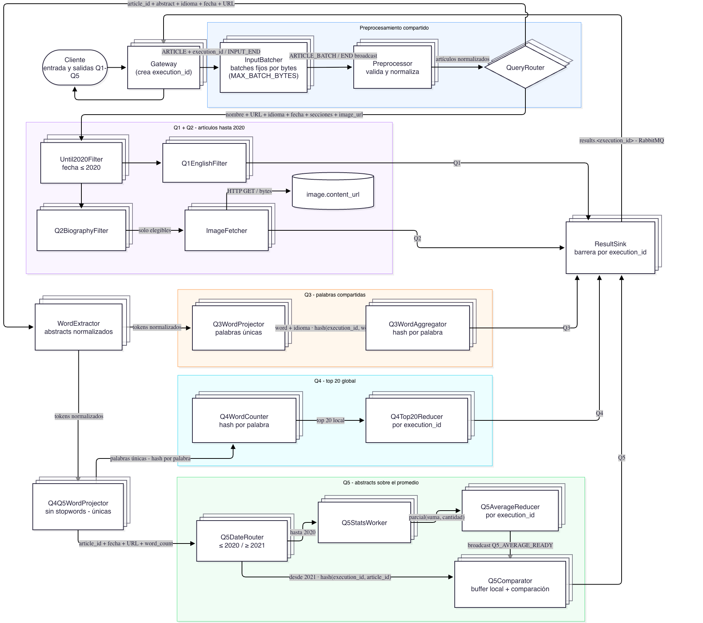
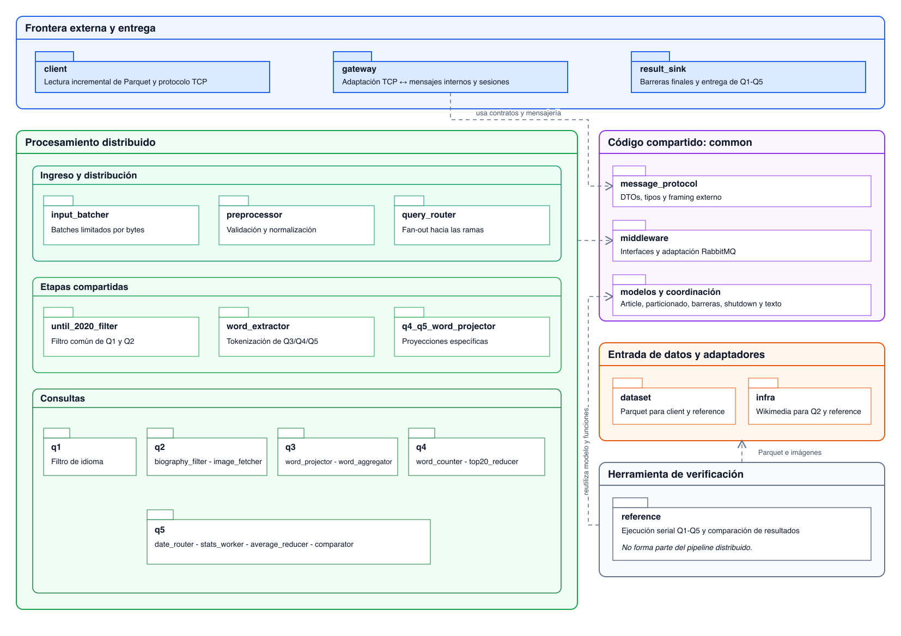
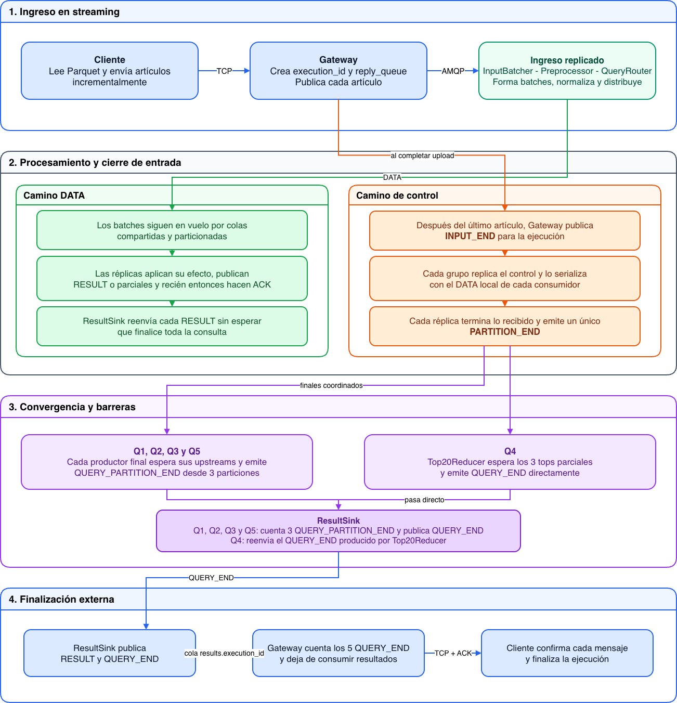
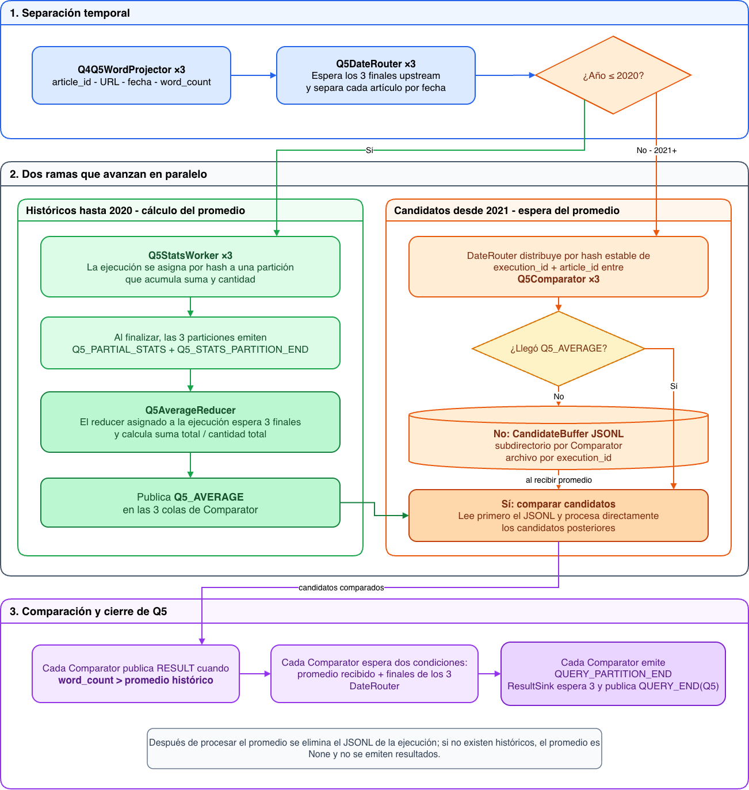
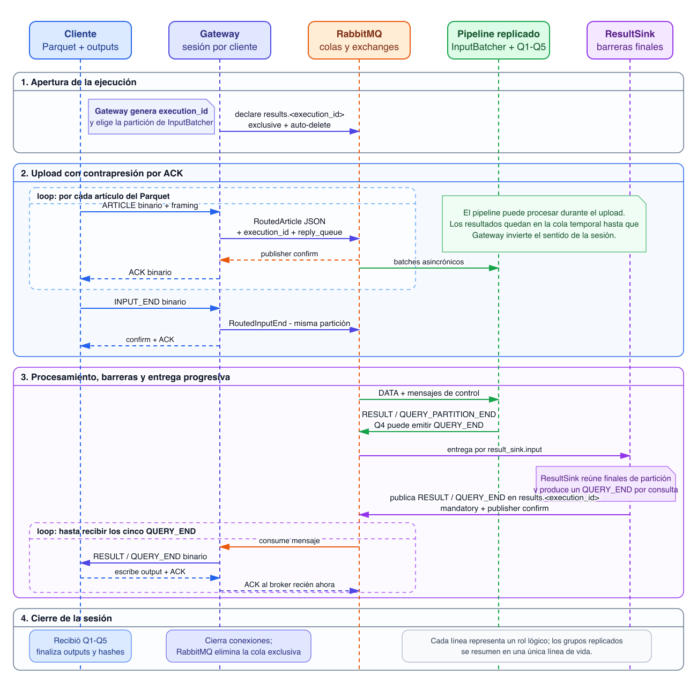
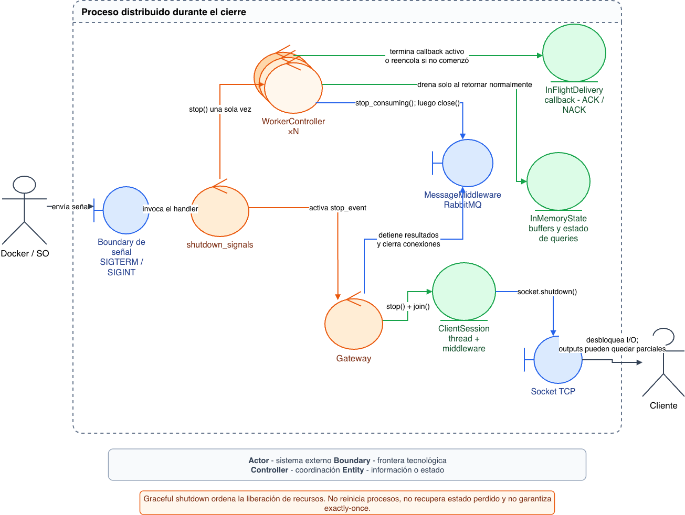
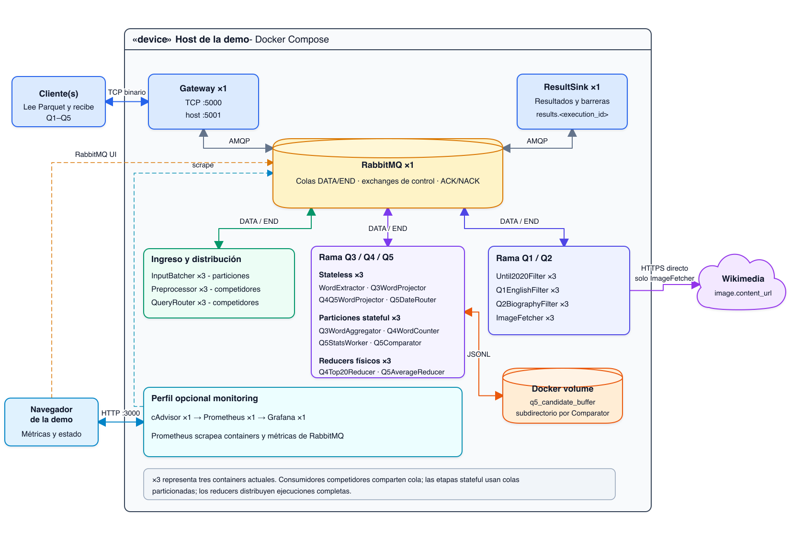

# Wikipedia Article Analysis - Informe

## 1. Resumen ejecutivo

El sistema analiza en forma distribuida artículos de Wikipedia en inglés y francés y produce cinco consultas independientes. La entrada se recibe como un stream de artículos, se normaliza una sola vez y se divide en dos ramas: una para las consultas Q1 y Q2, relacionadas con fecha, idioma, secciones e imágenes; y otra para Q3, Q4 y Q5, relacionada con el análisis textual de los abstracts.

La comunicación entre procesos se realiza mediante RabbitMQ, oculto por la capa propia de middleware. Los componentes que no mantienen estado pueden usar consumidores competidores sobre colas compartidas. Los componentes que necesitan reunir información relacionada utilizan particionado determinístico por una clave funcional, como `(execution_id, word)` o `execution_id`.

El diseño separa tres etapas de evolución:

1. **Pipeline funcional:** una réplica por componente y finales simples para validar las cinco consultas de punta a punta.
2. **Escalabilidad, dentro de este mismo TP:** múltiples réplicas, protocolo de control, `PARTITION_END`, barreras, clientes concurrentes y graceful shutdown completo.
3. **Tolerancia a fallos, en el TP posterior.**

---

## 2. Alcance y requerimientos

### 2.1 Requerimientos funcionales

El sistema recibe artículos de Wikipedia en francés e inglés y genera cinco salidas:

1. **Q1 - Artículos en inglés hasta 2020:** URL y fecha de modificación de los artículos escritos en inglés cuya fecha de modificación sea hasta 2020 inclusive.
2. **Q2 - Biografías e imágenes:** nombre, URL e imagen en bytes de los artículos hasta 2020 inclusive que contengan una sección denominada `biography` o `biographie`, sin distinguir mayúsculas y minúsculas.
3. **Q3 - Palabras compartidas:** listado sin duplicados de palabras presentes en al menos un artículo en inglés y al menos un artículo en francés.
4. **Q4 - Top 20 global:** veinte palabras más utilizadas entre todos los abstracts, excluyendo stopwords. Dentro de un mismo abstract cada palabra se contabiliza como máximo una vez.
5. **Q5 - Abstracts sobre el promedio histórico:** URL y cantidad de palabras de los artículos desde 2021 cuyo abstract supere el promedio de palabras de los abstracts hasta 2020 inclusive. Se utiliza el mismo criterio de conteo que Q4.

Cada cliente realiza una única ejecución. Distintos clientes deben poder ejecutarse concurrentemente y sin compartir estado accidentalmente. Cuando una ejecución termina o se aborta, sus recursos temporales deben limpiarse eventualmente.

### 2.2 Requerimientos no funcionales

- Procesar la entrada y entregar la salida como streams, sin cargar el dataset ni los resultados completos en memoria.
- Desplegar múltiples procesos en containers mediante Docker Compose.
- Utilizar RabbitMQ para comunicar containers.
- Ocultar los detalles de conectividad y grupos detrás de un middleware propio.
- Escalar al aumentar el volumen de una ejecución y la cantidad de clientes concurrentes.
- Permitir que al menos el 50 % de los tipos de controllers pueda escalar horizontalmente.
- Coordinar correctamente las etapas con dependencias, reductores, joiners y barreras.
- Evitar `sleep` como mecanismo de sincronización y evitar spin locks.
- Responder ordenadamente a `SIGTERM`.
- Comparar automáticamente la salida distribuida con una ejecución serial de referencia.
- Propagar solamente las columnas necesarias a cada etapa.

---

## 3. Fuente de datos y referencia funcional

### 3.1 Dataset

Se utiliza Wikipedia Structured Contents, publicado en Kaggle. Para la demo trabajmos con una muestra reproducible de 4.500.000 artículos.

La muestra se genera en Kaggle mediante el notebook del grupo y se descarga como `wikipedia_test.parquet`. El archivo no se versiona en Git debido a su tamaño. El cliente lo recorre incrementalmente con PyArrow en lugar de cargarlo completo en memoria.

### 3.2 Ejecución serial

Antes de distribuir el procesamiento se implementó una referencia serial propia para Q1-Q5. Esta referencia tiene dos propósitos:

- Fijar una interpretación ejecutable de las consultas.
- Actuar como test para validar la salida distribuida.

La comparación automática ignora el orden de las líneas y de las claves JSON, pero conserva la multiplicidad. De esta manera detecta tanto resultados faltantes como resultados duplicados o adicionales. Esta decisión es importante porque un sistema distribuido puede cambiar legítimamente el orden, pero no el conjunto ni la cantidad de resultados.

### 3.3 Normalización textual acordada

La interpretación funcional utilizada por la referencia y prevista para el pipeline distribuido es:

1. Convertir el texto a minúsculas.
2. Tokenizar con una regla equivalente a `\b\w+\b`.
3. Descartar tokens exclusivamente numéricos.
4. Conservar el idioma del artículo.
5. Eliminar stopwords inglesas y francesas solamente para Q4 y Q5.
6. Deduplicar palabras dentro de cada abstract antes de contabilizarlas para Q4 y Q5.

Q3 no elimina stopwords porque la consigna solicita todas las palabras compartidas entre idiomas. Q4 y Q5 comparten exactamente la misma definición de palabra contabilizable para evitar que el promedio de Q5 se calcule con una métrica diferente.

---

## 4. Organización del informe según 4+1 Views

La arquitectura se documenta con el modelo 4+1:

| Vista | Pregunta que responde | Diagramas previstos |
|---|---|---|
| Escenarios (+1) | ¿Qué casos de uso y recorridos debe soportar el sistema? | Robustez |
| Lógica | ¿Qué responsabilidades existen y cómo se transforma la información? | DAG |
| Procesos | ¿Qué ocurre en el tiempo y cómo se coordinan procesos concurrentes? | Actividades y secuencia |
| Desarrollo | ¿Cómo se organizan los paquetes y sus dependencias? | Paquetes |
| Física | ¿Dónde se despliegan los procesos y cómo se conectan? | Despliegue |

### 4.1 Inventario de diagramas


#### Vista lógica - DAG

El siguiente DAG representa el flujo completo de datos de la arquitectura objetivo, desde el ingreso de los artículos hasta la entrega de los resultados de Q1-Q5. Los bloques apilados representan componentes replicables.



#### Vista de desarrollo - Paquetes

El siguiente diagrama representa la organización real del código fuente. Los
paquetes se agrupan por responsabilidad y las flechas punteadas indican
dependencias de código relevantes, no el recorrido de los mensajes.




#### Vista de procesos - Actividades

Este diagrama separa el procesamiento de datos del protocolo de control. Permite
observar que `INPUT_END` solamente cierra la entrada, mientras las réplicas aún
pueden tener trabajo en vuelo, y que la ejecución termina recién cuando se
completan las barreras de las cinco consultas.



La Query 5 requiere una coordinación adicional porque sus dos ramas avanzan en
paralelo: una calcula el promedio histórico y la otra recibe los artículos que
deberán compararse contra ese promedio. El siguiente diagrama muestra la
separación temporal, el almacenamiento transitorio de candidatos y las
condiciones necesarias para cerrar la consulta.




#### Vista de procesos - Secuencia

La siguiente secuencia muestra una ejecución completa desde la conexión del
cliente hasta el cierre de sus archivos de salida. Para conservar la
legibilidad, cada línea de vida representa un rol lógico: el pipeline agrupa a
los componentes y réplicas de Q1-Q5, mientras las flechas explicitan dónde se
producen las confirmaciones que aplican contrapresión y preservan la entrega.




#### Vista de escenarios - Robustez

Esta vista aplica los estereotipos de robustez al cierre iniciado por una señal
`SIGTERM` o `SIGINT`. Separa a los actores externos, las fronteras tecnológicas,
los controllers que coordinan el cierre y las entidades que representan estado
en vuelo o almacenado. El controller apilado representa a los workers
replicados; las asociaciones muestran qué recurso detiene o libera cada parte,
no el orden temporal exacto.




#### Vista física - Despliegue

El siguiente diagrama representa el entorno ejecutado durante la demo: un host
con Docker Compose, los grupos replicados, RabbitMQ, el almacenamiento temporal
de Q5 y el perfil opcional de monitoreo.




---

## 5. Vista lógica: arquitectura general


### 5.1 Principios de diseño

1. **Streaming:** cada artículo avanza sin esperar que se cargue el dataset completo.
2. **Responsabilidad única:** cada etapa realiza una transformación acotada.
3. **Trabajo común antes de bifurcar:** se comparte la normalización y, para Q1/Q2, el filtro temporal.
4. **Proyecciones mínimas:** una rama recibe solamente los campos que necesita.
5. **Separación entre negocio y transporte:** controllers y lógica funcional no dependen directamente de Pika.
6. **Stateless cuando es posible:** facilita consumidores competidores y escalamiento horizontal.
7. **Afinidad explícita cuando hay estado:** las claves relacionadas convergen mediante hash estable.
8. **Finalización explícita:** `INPUT_END`, `PARTITION_END` y `QUERY_END` representan hechos diferentes.
9. **Estado de aplicación fuera de RabbitMQ:** MOM transporta mensajes, pero no reemplaza un almacenamiento temporal propio.

### 5.2 Componentes, responsabilidades y estado

| Componente | Responsabilidad | Naturaleza objetivo | Clave de distribución | Estado actual |
|---|---|---|---|---|
| Client | Leer Parquet, enviar artículos y escribir Q1-Q5 | Externo, uno por ejecución | - | Implementado |
| Gateway | Crear ejecución, adaptar TCP/MOM y devolver resultados | Una sesión concurrente por conexión | `execution_id` | Implementado con un thread y recursos aislados por cliente |
| InputBatcher | Agrupar registros sin superar el límite de bytes | Stateful por ejecución | `execution_id` | Implementado, tres particiones con routing estable |
| Preprocessor | Validar y normalizar artículos | Stateless, replicable | Cola compartida | Implementado, tres réplicas con control distribuido |
| QueryRouter | Proyectar y bifurcar el flujo | Stateless, replicable | Cola compartida | Implementado, tres réplicas con control distribuido |
| Until2020Filter | Aplicar una vez `fecha <= 2020` | Stateless, replicable | Cola compartida | Implementado, tres réplicas con control distribuido |
| Q1EnglishFilter | Filtrar inglés y producir Q1 | Stateless, replicable | Cola compartida | Implementado, tres réplicas con control distribuido |
| Q2BiographyFilter | Detectar sección biográfica | Stateless, replicable | Cola compartida | Implementado, tres réplicas con control distribuido |
| ImageFetcher | Descargar imagen y producir Q2 | Replicable, I/O-bound | Cola compartida | Implementado, tres réplicas con descarga secuencial por instancia |
| WordExtractor | Tokenización básica compartida | Stateless, replicable | Cola compartida | Implementado, tres réplicas coordinadas |
| Q3WordProjector | Palabras únicas de cada artículo | Stateless, replicable | Cola compartida | Implementado, tres réplicas coordinadas |
| Q3WordAggregator | Presencia por idioma | Stateful y particionado | `(execution_id, word)` | Implementado, tres particiones con `QUERY_PARTITION_END` |
| Q4Q5WordProjector | Stopwords, deduplicación y `word_count` | Stateless, replicable | Cola compartida | Implementado, tres réplicas coordinadas |
| Q4WordCounter | Conteo global distribuido y top local | Stateful y particionado | `(execution_id, word)` | Implementado, tres particiones con barrera |
| Q4Top20Reducer | Fusionar tops locales | Stateful, reducers replicados | `execution_id` | Implementado, tres reducers físicos |
| Q5DateRouter | Separar histórico y candidatos | Stateless, replicable | Cola compartida | Implementado, tres réplicas coordinadas |
| Q5StatsWorker | Suma y cantidad parciales | Stateful por ejecución local | `execution_id` | Implementado, tres particiones con afinidad estable |
| Q5AverageReducer | Calcular promedio global | Stateful, reducer lógico | `execution_id` | Implementado, tres reducers físicos y barrera de tres workers |
| Q5Comparator | Esperar promedio y comparar candidatos | Stateful y particionado | `(execution_id, article_id)` | Implementado, tres particiones con buffers JSONL aislados |
| ResultSink | Reenviar resultados y consolidar finales hacia cada Gateway | Stateful por barreras | `execution_id` | Implementado con una instancia y barreras por query |
| MessageMiddleware | Abstraer queues, publicación dinámica, ACK/NACK y grupos | Infraestructura común | - | Queue, publisher dinámico y exchange directo implementados sobre RabbitMQ |

### 5.3 Estado del flujo implementado

Actualmente el camino funcional de Q1-Q5 converge en ResultSink y desde allí llega a las colas temporales `results.<execution_id>` que consume Gateway.

El QueryRouter publica la proyección textual en `word_extractor.input`. Tres WordExtractors tokenizan los abstracts y alimentan las ramas de Q3 y Q4/Q5. Tres Q3WordProjectors deduplican palabras por artículo y las enrutan por `(execution_id, word)` hacia tres Q3WordAggregators. En Q4, tres projectors enrutan palabras hacia tres counters; los tops parciales de una ejecución convergen en uno de tres reducers. En Q5, tres DateRouters separan conteos históricos y candidatos; tres StatsWorkers y tres AverageReducers calculan promedios de ejecuciones distintas en paralelo, mientras tres Comparators reciben candidatos por `(execution_id, article_id)` y usan buffers aislados. ResultSink consume los resultados y finales de Q1-Q5 y los reenvía inmediatamente a `results.<execution_id>`, desde donde Gateway los entrega al cliente mediante el protocolo TCP externo.

---

## 6. Identidad, aislamiento y particionado

### 6.1 `execution_id`

Gateway genera un identificador globalmente único para cada corrida mediante UUID. Todos los mensajes internos incluyen `execution_id`. Este identificador permite:

- Mantener separados los datos y estados de clientes concurrentes.
- Asignar una ejecución a una partición estable.
- Dirigir resultados a la cola temporal correcta.
- Indexar los estados de agregadores y reductores.
- Limpiar recursos al completar o abortar una corrida.

La cola de respuesta se denomina `results.<execution_id>`. Actualmente es exclusiva y autoeliminable, porque pertenece a una única conexión del Gateway.

### 6.2 `article_id`

El pipeline textual necesita identificar de manera estable cada artículo, especialmente en Q5. Los candidatos de esa query pueden quedar temporalmente guardados mientras se calcula el promedio y se distribuyen entre los comparadores mediante la clave `(execution_id, article_id)`. El identificador permite reconocer a qué artículo corresponde cada candidato, enviarlo siempre a la misma partición y, en una etapa posterior de tolerancia a fallos, detectar una posible reentrega del mismo artículo.

El dataset no provee un identificador independiente, por lo que actualmente se utiliza la URL como valor de `article_id`. Aunque hoy ambos campos contengan el mismo string, representan conceptos distintos: `url` es un dato del resultado que debe mostrarse al usuario, mientras que `article_id` es una identidad interna utilizada para routing y seguimiento. Mantenerlos separados evita acoplar esas responsabilidades y permite adoptar otro identificador en el futuro sin cambiar el significado de la URL.

### 6.3 Hash estable

No se utiliza `hash()` de Python para elegir particiones porque su resultado está aleatorizado entre procesos. Se utiliza SHA-256 y luego módulo por la cantidad de particiones:

```text
partition = sha256(key) mod partition_count
```

El objetivo es determinismo, la misma clave debe producir la misma partición en cualquier proceso y después de un reinicio.

### 6.4 Colas compartidas y colas particionadas

- Una etapa **stateless** puede consumir de una cola compartida. RabbitMQ distribuye cada mensaje a una sola réplica competidora.
- Una etapa **stateful** necesita afinidad. El productor elige explícitamente la cola de partición según una clave estable.
- Un reducer por ejecución también puede ser físicamente replicado: todos los parciales de una corrida convergen en una réplica lógica por `execution_id`, mientras otras corridas pueden usar otras réplicas.

---

## 7. Ingreso, streaming y batching

### 7.1 Cliente y protocolo TCP

El cliente itera el Parquet y envía un artículo por vez. Cada artículo debe ser confirmado por Gateway antes de continuar. Al terminar envía `INPUT_END` y luego recibe resultados progresivamente.

TCP es un stream de bytes, no un transporte de mensajes. Por eso cada frame externo se representa como:

```text
4 bytes: longitud del cuerpo, unsigned, network byte order
N bytes: cuerpo del mensaje
```

El receptor continúa leyendo hasta completar exactamente la longitud indicada. Esto evita asumir que una llamada a `recv` coincide con un mensaje completo.

El cuerpo se serializa mediante un protocolo binario propio. El primer byte identifica el tipo de mensaje externo y los valores posteriores utilizan etiquetas binarias para representar `None`, booleanos, enteros, floats, strings UTF-8, bytes, listas y diccionarios. Los valores variables incluyen su longitud en cuatro bytes y los enteros se representan con signo en ocho bytes. El decoder rechaza tipos desconocidos, mensajes truncados, UTF-8 inválido y bytes sobrantes.

El cliente no genera el JSON interno del sistema. Lee el Parquet incrementalmente, codifica cada artículo con este protocolo y lo envía por TCP. Gateway decodifica el artículo, agrega `execution_id` y `reply_queue`, construye el DTO interno y recién entonces lo serializa como JSON UTF-8 para publicarlo en RabbitMQ. La misma codificación binaria se utiliza para ACK, errores y resultados enviados por la conexión externa.

### 7.2 Gateway

Gateway adapta el protocolo externo a mensajes internos:

1. Acepta una conexión.
2. Crea `execution_id`.
3. Crea la cola temporal `results.<execution_id>`.
4. Asigna la ejecución a una partición de InputBatcher.
5. Agrega `execution_id` y `reply_queue` a artículos y al final de entrada.
6. Publica en RabbitMQ.
7. Después de publicar cada artículo individual en RabbitMQ, envía al cliente un ACK por TCP; también confirma `INPUT_END` de la misma manera.
8. Cuando recibe `INPUT_END`, deja de recibir artículos y comienza la fase de resultados: consume mensajes desde `results.<execution_id>` en RabbitMQ y envía cada `RESULT` o `QUERY_END` al cliente por la misma conexión TCP.

El ACK del ítem 7 pertenece al protocolo externo y se produce una vez por
artículo, antes del batching. El cliente envía un `ARTICLE` y espera; Gateway lo
transforma en `ROUTED_ARTICLE`, lo publica en la partición de InputBatcher y,
cuando RabbitMQ acepta la publicación mediante publisher confirms, responde
`ACK` por TCP. Recién entonces el cliente envía el artículo siguiente. Al
terminar la entrada se repite la secuencia con `INPUT_END`. Este ACK significa
que el broker aceptó el mensaje, no que el artículo ya recorrió el pipeline ni
que sus resultados fueron calculados.

La conexión tiene entonces dos fases. Primero el cliente envía artículos y Gateway los publica en RabbitMQ. Después de `INPUT_END`, el flujo se invierte: Gateway recibe los resultados producidos por el sistema distribuido y los transmite al cliente. Por cada resultado, espera el ACK por TCP del cliente antes de ejecutar el ACK de consumo en RabbitMQ.

La implementación actual acepta conexiones concurrentes y ejecuta cada sesión en un thread independiente, con conexiones RabbitMQ y una cola exclusiva de resultados propias. Si un cliente se desconecta durante el upload, Gateway publica `INPUT_END` y cierra inmediatamente la sesión sin esperar su salida. El cierre elimina `results.<execution_id>`; los resultados que lleguen posteriormente se descartan de forma ordenada en ResultSink.

### 7.3 InputBatcher limitado por bytes

Los batches se limitan por tamaño serializado real, no por cantidad de artículos. Un número fijo de artículos no controla el consumo porque los abstracts y las secciones tienen tamaños muy variables.

Para cada artículo:

1. Se construye el batch candidato.
2. Se serializa para medir su tamaño final.
3. Si no supera `MAX_BATCH_BYTES`, se conserva.
4. Si lo supera, se publica el batch anterior y el artículo inicia el siguiente.
5. Si un artículo individual supera el límite, se produce un error visible.
6. Ante `INPUT_END`, se publica el último batch parcial antes del final.

El InputBatcher mantiene estado por ejecución. Por eso todos los artículos y el final de una ejecución deben llegar a la misma partición. Distintas ejecuciones sí pueden asignarse a distintas particiones. Compose despliega tres colas e instancias con identificadores `0`, `1` y `2`; Gateway calcula la partición mediante SHA-256 sobre `execution_id`. Cada cola tiene un solo consumidor, mientras las tres instancias comparten `preprocessor.input` como salida.

---

## 8. Preprocesamiento y fan-out

### 8.1 Preprocessor

El Preprocessor convierte el registro crudo en un `NormalizedArticle`:

- Valida `name` y `url`.
- Extrae y normaliza el identificador de idioma.
- Parsea la fecha ISO.
- Transforma las secciones, almacenadas como JSON dentro del Parquet, en una lista de nombres.
- Obtiene `image.content_url` cuando existe.
- Conserva el abstract opcional.

Esta separación evita repetir parsing en cada consulta.

### 8.2 QueryRouter

QueryRouter publica dos proyecciones mínimas:

- **Q1/Q2:** `name`, `url`, `language`, `modification_date`, `sections`, `image_url`.
- **Q3/Q4/Q5:** `article_id`, `url`, `language`, `modification_date`, `abstract`.

No filtra fecha, idioma, secciones ni palabras. Su responsabilidad es el fan-out y la reducción de columnas. El ACK de consumo en RabbitMQ ocurre después de publicar ambas salidas.

El fan-out actual tiene semántica at-least-once: si una publicación funciona y la siguiente falla, una reentrega podría repetir la primera.

---

## 9. Rama Q1/Q2

### 9.1 Filtro temporal compartido

Q1 y Q2 requieren `fecha <= 2020`. Aplicar el filtro por separado duplicaría trabajo y podría introducir interpretaciones diferentes. `Until2020Filter` evalúa la condición una sola vez y proyecta los artículos elegibles hacia ambas consultas.

Los batches vacíos no se publican. Tres réplicas consumen la cola compartida y coordinan el cierre mediante `until_2020.control`. Cada una emite su propio final después de observar los tres QueryRouters. Q1 y Q2BiographyFilter despliegan a su vez tres consumidores competidores y difunden esos finales mediante sus propios exchanges de control. Esto permite que una consulta sin candidatos termine correctamente.

### 9.2 Query 1

Q1 conserva únicamente artículos con idioma normalizado `en` y produce:

```text
{
  "url": ...,
  "modification_date": ...
}
```

La fecha conserva el formato ISO de la referencia serial. Tres réplicas stateless compiten por los batches de candidatos. El primer final de Until2020Filter que atraviesa la cola compartida se difunde mediante `q1.control`; cada réplica espera los tres IDs de origen y emite su propio `QUERY_PARTITION_END`. ResultSink completa la barrera de Q1 al recibir los IDs `{0, 1, 2}` y publica un único `QUERY_END`.

### 9.3 Query 2: filtro biográfico

`Q2BiographyFilter` compara el nombre completo de cada sección con `biography` o `biographie`, ignorando mayúsculas. No realiza búsquedas parciales: una sección cuyo nombre solamente contenga la palabra no cumple necesariamente la condición.

El filtro conserva candidatos sin `image_url`. La decisión de omitirlos y registrarlos pertenece a ImageFetcher, que es el componente responsable de la interacción externa.

Tres réplicas compiten por los batches biográficos. La que recibe un final de Until2020Filter lo difunde mediante `q2_biography_filter.control`; después de observar los tres IDs de origen, cada réplica publica su propio `PARTITION_END(stage="q2_biography_filter")`. Tres ImageFetchers compiten por los candidatos y difunden esos finales mediante `image_fetcher.control`. Cada uno espera los IDs biográficos `{0, 1, 2}` y emite su propio `QUERY_PARTITION_END`; ResultSink completa Q2 al recibir los tres IDs de ImageFetcher.

### 9.4 Query 2: descarga de imágenes

El dataset puede incluir `image.content_url`, una URL que apunta directamente al recurso de imagen. ImageFetcher realiza un HTTP GET a esa URL. La respuesta HTTP contiene headers y un cuerpo; el cuerpo se lee como `bytes` y constituye la imagen solicitada por la query.

La cátedra confirmó que es válido utilizar directamente la URL del dataset y que no es necesario consultar adicionalmente la API REST de Wikimedia. La política implementada es:

- Éxito: leer el cuerpo completo y continuar.
- HTTP 404: error permanente, registrar y omitir sin reintentar.
- Otros HTTP 4xx: registrar y omitir, salvo 429.
- HTTP 429, 5xx, timeout o error transitorio de red: reintentos acotados.
- URL ausente o reintentos agotados: registrar la omisión y continuar la ejecución.

La API REST se descartó porque no agrega información cuando la página no posee imagen y porque consultar datos actuales podría introducir una inconsistencia temporal con el snapshot del Parquet.

Como los mensajes internos de RabbitMQ y el archivo `query2.jsonl` utilizan JSON, los bytes se codifican en Base64 para formar un string transportable y escribible. Base64 aumenta el tamaño aproximadamente un 33 %. Aunque el protocolo externo admite bytes, el resultado ya llega al Gateway representado como Base64; cambiar solamente el último tramo no elimina ese overhead dentro del pipeline.

#### 9.4.1 Rate limiting de Wikimedia

Aunque el sistema no consulta la API REST, las descargas directas realizadas a
`upload.wikimedia.org` están alcanzadas por la
[Robot policy de Wikimedia](https://wikitech.wikimedia.org/wiki/Robot_policy).
Para recursos multimedia, la política indica una concurrencia total máxima de
dos solicitudes y una velocidad total máxima de 25 Mbps, medida en ventanas de
diez segundos. También exige identificar el cliente mediante un `User-Agent`
significativo y respetar el header HTTP `Retry-After` recibido junto con un
`429`. La documentación general de
[rate limits](https://www.mediawiki.org/wiki/Wikimedia_APIs/Rate_limits)
recomienda, cuando ese header no está presente, esperar al menos cinco segundos
o aplicar exponential backoff.

Un `429` no expresa una cantidad máxima fija de imágenes. Es una instrucción del
servidor para reducir temporalmente el ritmo y su respuesta puede indicar mediante
`Retry-After` cuánto debe esperar el cliente. Los límites se aplican al tráfico
agregado hacia las propiedades de Wikimedia, no de manera independiente por URL,
archivo o proceso. Además, Wikimedia advierte que los valores y mecanismos de
rate limiting pueden cambiar, por lo que el cliente debe reaccionar al protocolo
HTTP y no depender de una cantidad de solicitudes observada experimentalmente.

---

## 10. Rama textual Q3/Q4/Q5

Esta sección describe la rama textual replicada implementada para Q3, Q4 y Q5.

### 10.1 WordExtractor

WordExtractor realiza solamente las transformaciones textuales comunes a Q3,
Q4 y Q5. Para cada abstract convierte el texto a minúsculas y aplica la expresión
regular `\b\w+\b`, que extrae secuencias de caracteres de palabra y utiliza los
espacios y signos de puntuación como separadores. Luego descarta los tokens
formados exclusivamente por números. Por ejemplo:

```text
"Python is great! Python was created in 1991"
-> ["python", "is", "great", "python", "was", "created", "in"]
```

Un token alfanumérico como `covid19` se conserva.

En esta etapa se preservan tanto las repeticiones como las stopwords. Tokenizar
no implica todavía deduplicar, contar palabras ni eliminar términos como `the`,
`is`, `de` o `la`: Q3 y Q4/Q5 aplican después reglas diferentes sobre la misma
representación tokenizada. WordExtractor tampoco filtra por fecha. Conserva
`article_id`, URL, idioma y fecha de modificación junto con la lista `words`.

Cada artículo tokenizado incluye además `has_abstract`. Un abstract ausente
(`None`) y uno presente pero vacío producen la misma lista de palabras vacía,
pero no representan el mismo caso para Q5. `has_abstract` mantiene esa diferencia
y permite reproducir correctamente el denominador de la referencia serial.

Tres réplicas transforman `TextArticleBatchMessage` en
`TokenizedArticleBatchMessage` y publican el mismo batch en las colas
independientes de Q3 y Q4/Q5. Q3 deduplica posteriormente las palabras dentro de
cada artículo sin eliminar stopwords. Q4/Q5 deduplican y eliminan stopwords antes
de contabilizarlas. Las réplicas coordinan los tres finales de QueryRouter
mediante `word_extractor.control` y cada una emite su propio `PARTITION_END` hacia
ambas ramas.

### 10.2 Q3: palabras compartidas

Tres Q3WordProjectors deduplican las palabras dentro de cada artículo y publican `(execution_id, word, language)`. No eliminan stopwords. Cada presencia se enruta por `(execution_id, word)` hacia una de tres particiones de Q3WordAggregator.

`Q3WordAggregator` se particiona por `(execution_id, word)` y mantiene:

```text
seen_en
seen_fr
emitted
```

Cuando una palabra pasa por primera vez a estar presente en ambos idiomas se emite el resultado y se marca `emitted`. Una colisión del hash solamente coloca dos palabras en la misma réplica, no mezcla sus claves en el estado interno. Cada aggregator espera los finales de los tres projectors y publica su `QUERY_PARTITION_END`; ResultSink espera los IDs `{0, 1, 2}` antes de producir el único cierre de Q3.

### 10.3 Q4: top 20 global

`Q4Q5WordProjector` omite los artículos cuyo abstract era `None`, elimina
stopwords, deduplica palabras dentro de cada artículo y publica un
`Q4WordBatchMessage` con una aparición por palabra y artículo. Las palabras se
particionan por `(execution_id, word)` entre tres colas `q4_word_counter.input.<partition>`.
Las repeticiones entre artículos se preservan porque
representan apariciones diferentes.

Cada Q4WordCounter mantiene un `Counter` por `execution_id`. Después de recibir los finales de los tres projectors publica su top 20 local seguido de `Q4PartitionEndMessage(partition_id)`. Los parciales se enrutan por `execution_id` hacia uno de tres Q4Top20Reducers físicos. El reducer elegido espera los finales de los tres counters, ordena los candidatos por conteo descendente y palabra ascendente, publica un `ResultMessage` por palabra y finalmente el único `QUERY_END` de Q4. Enviar solamente veinte candidatos por partición es suficiente: una palabra fuera del top 20 local ya tiene al menos veinte palabras de su propia partición que la superan o empatan según el criterio de orden, por lo que no puede ingresar al top 20 global.

### 10.4 Q5: promedio y comparación

Esta coordinación se resume visualmente en el segundo diagrama de la
[vista de procesos - Actividades](#vista-de-procesos---actividades).

`Q4Q5WordProjector` calcula también `word_count = len(unique_words)`, garantizando el mismo criterio que Q4, y publica un `Q5ArticleWordCountBatchMessage` en `q5_date_router.input`. La proyección conserva `article_id`, URL y fecha. Los artículos sin abstract se omiten, mientras que los abstracts presentes pero vacíos se conservan con conteo cero, como en la ejecución serial.

Tres Q5DateRouters consumen `Q5ArticleWordCountBatchMessage`, omiten las salidas vacías y dividen el flujo:

- Conteos hasta 2020 en `Q5HistoricalWordCountBatchMessage`, enrutados por `execution_id` hacia un StatsWorker.
- Identificador `article_id`, URL y conteo desde 2021 en `Q5CandidateBatchMessage`, enrutados por `(execution_id, article_id)` hacia un Comparator.

Los DateRouters coordinan los finales de los tres Q4Q5WordProjectors y cada uno publica su propio `PARTITION_END` en todas las colas de StatsWorker y Comparator.

Tres Q5StatsWorkers acumulan `total_word_count` y `abstract_count` por ejecución. Cada ejecución histórica pertenece a un solo worker. Después de recibir los finales de los tres DateRouters, publica `Q5PartialStatsMessage` seguido de `Q5StatsPartitionEndMessage`.

Los parciales históricos convergen por `execution_id` en `Q5AverageReducer`, que espera los finales de la cantidad configurada de particiones y calcula:

```text
average = global_sum / global_count
```

Los parciales de una ejecución se enrutan hacia uno de tres AverageReducers físicos. El reducer lógico espera los finales de los tres StatsWorkers y luego difunde `Q5AverageMessage` a las tres colas de comparadores, porque una ejecución puede tener candidatos en las tres particiones.

Los candidatos pueden llegar antes que el promedio. No se mantienen sin ACK de consumo dentro de RabbitMQ porque eso usaría la MOM como base de datos y limitaría el flujo. Cada comparator ejecuta ese ACK después de incorporarlos a un `CandidateBuffer` de la aplicación, separado por ejecución. La implementación utiliza un archivo JSONL append-only por `execution_id`, cuyo nombre se deriva mediante SHA-256. Cada una de las tres particiones usa un subdirectorio propio de `/var/lib/q5-candidates`, respaldado por el volumen Docker `q5_candidate_buffer`, y recorre los archivos línea por línea para evitar memoria ilimitada.

El comparator mantiene una máquina de estados con:

```text
average_ready
average
candidate_input_closed
buffer
```

Antes del promedio persiste candidatos; después del promedio compara directamente los nuevos y drena los anteriores. Cada comparator finaliza cuando conoce el promedio, recibió los finales de los tres DateRouters y no quedan candidatos pendientes. En ese momento publica su `QUERY_PARTITION_END` y elimina el archivo temporal. ResultSink espera los tres comparators antes de publicar el único `QUERY_END` de Q5. La comparación es estricta: `word_count > average`.

---

## 11. ResultSink y entrega al cliente

La implementación actual de ResultSink consume `result_sink.input` y reenvía cada `ResultMessage` a `results.<execution_id>` sin acumular resultados. Para el cierre mantiene una barrera genérica por `(execution_id, query_id)`: cada `QueryPartitionEndMessage` agrega un `partition_id` a un conjunto y, al alcanzar la cantidad configurada para esa query, ResultSink publica exactamente un `QueryEndMessage`. Los duplicados recibidos antes de completar la barrera no incrementan el conjunto. Q1, Q2, Q3 y Q5 utilizan esta barrera con tres particiones. Q4 publica un `QueryEndMessage` directo porque todos los parciales de una ejecución convergen en un único reducer lógico. ResultSink publica mediante el exchange por defecto de RabbitMQ con enrutamiento obligatorio y publisher confirms; recién después de que el broker confirma esa publicación ejecuta el ACK de consumo del mensaje de entrada.

ResultSink no declara las colas de salida. Cada cola `results.<execution_id>` es exclusiva, temporal y pertenece a la conexión de Gateway que inició la ejecución. El publicador dinámico solamente la utiliza como destino. Si la cola no existe porque el cliente se desconectó, la publicación obligatoria produce un error de mensaje no enrutable: ResultSink registra el descarte y confirma la entrada. Los demás errores de publicación continúan produciendo NACK.

La versión actual utiliza una sola instancia, por lo que toda la salida converge en el mismo estado de barrera. Al replicar ResultSink se lo particionará por `execution_id` para conservar esa propiedad. Sus responsabilidades son:

- Reenviar cada resultado a `results.<execution_id>` sin esperar a que termine la query, ya implementado.
- Mantener las barreras necesarias por consulta, ya implementado en la instancia única.
- Producir exactamente un `QUERY_END` por query, ya implementado para productores que adopten `QUERY_PARTITION_END`.
- Limpiar el estado de barrera cuando finalicen las cinco consultas o falle la ejecución.

Gateway consume la cola temporal de la ejecución y aplica las dos clases de ACK de forma encadenada:

```text
RabbitMQ entrega resultado
  -> Gateway valida
  -> Gateway envía por TCP
  -> Client escribe y responde ACK por TCP
  -> Gateway ejecuta el ACK de consumo en RabbitMQ
```

Esta secuencia evita confirmar un resultado antes de entregarlo al cliente. Sin embargo, todavía no garantiza una entrega **exactly-once**, es decir, que cada resultado lógico llegue al cliente una única vez incluso si ocurren reintentos o caídas.

Por ejemplo, el cliente podría escribir un resultado y responder ACK, pero Gateway podría caerse antes de confirmar ese mensaje en RabbitMQ. Al recuperarse, RabbitMQ podría entregarlo nuevamente y el cliente lo escribiría dos veces. Evitar esa duplicación requiere identificar persistentemente los resultados ya procesados y deduplicarlos. Esa garantía corresponde al hito posterior de tolerancia a fallos.

---

## 12. Comunicación interna y middleware

### 12.1 Motivo del middleware

Los componentes no importan Pika ni administran conexiones RabbitMQ directamente. Utilizan interfaces del middleware para enviar, consumir, confirmar, rechazar y cerrar.

Esto cumple dos objetivos:

- Oculta detalles de conectividad, colas y ACK/NACK de RabbitMQ a la lógica funcional.
- Permite extender la comunicación con grupos sin modificar cada controller.

### 12.2 Capacidades actuales

La implementación actual ofrece `MessageMiddlewareQueueRabbitMQ` con:

- Declaración de colas.
- Publicación.
- Consumo bloqueante.
- ACK y NACK manuales de consumo.
- Configuración `prefetch_count=1`.
- Detención del consumo.
- Cierre explícito de conexión.
- Heartbeats AMQP deshabilitados para las conexiones bloqueantes actuales.

Las excepciones específicas de Pika se traducen a errores propios del middleware.

Los módulos de mensajería mantienen conexiones bloqueantes separadas para
consumo y publicación. Pika procesa heartbeats de una `BlockingConnection`
solamente cuando esa conexión atiende eventos. Durante una agregación larga, la
conexión de salida puede permanecer inactiva más de los 60 segundos negociados;
RabbitMQ la cerraría aunque el proceso continúe sano. Este comportamiento se
observó al ejecutar 50.000 artículos: varios componentes llegaron al final con
la conexión publicadora vencida. La configuración funcional usa `heartbeat=0`
para evitar falsos positivos. El costo es que una partición de red puede tardar
más en detectarse.

### 12.3 Comunicación por grupos

`MessageMiddlewareExchangeRabbitMQ` toma como base la versión utilizada en el TP de Coordinación. Declara un exchange `direct`; cada instancia consumidora crea su propia cola exclusiva y la vincula con las routing keys configuradas. Una instancia usada solamente para publicar declara el exchange sin crear una cola innecesaria. Cuando varias réplicas vinculan sus colas con la misma clave, una publicación de control llega a todas ellas. El negocio no conoce bindings ni detalles de RabbitMQ. DATA continúa usando colas compartidas o particionadas y el control de finalización utiliza este broadcast al grupo. El patrón está integrado en Preprocessor, QueryRouter, Until2020Filter, Q1EnglishFilter, Q2BiographyFilter, ImageFetcher, WordExtractor, Q3WordProjector, Q4Q5WordProjector y Q5DateRouter.

### 12.4 Publisher confirms, ACK, NACK y prefetch

RabbitMQ interviene en dos momentos diferentes. Un **publisher confirm** informa
al productor que el broker aceptó su publicación. En cambio, un **ACK de
consumo** informa que el consumidor terminó de procesar el mensaje que RabbitMQ
le había entregado y permite retirarlo de la cola. Un NACK rechaza esa entrega y,
según la política utilizada, puede solicitar su reencolado.

El ACK de consumo se produce por mensaje de RabbitMQ, no necesariamente por
artículo. Entre Gateway e InputBatcher cada mensaje contiene un solo artículo o
el final de entrada. Después de InputBatcher, un mensaje de DATA normalmente
contiene un batch. Más adelante también existen mensajes con parciales,
resultados y señales de control. En todos los controllers, el mensaje de entrada
se confirma solamente después de aplicar su efecto y publicar todas las salidas
derivadas. Ante una excepción, el controller hace NACK según la política de la
etapa.

`prefetch_count=1` limita a uno los mensajes no confirmados reservados por consumidor y favorece el reparto entre réplicas. No es un algoritmo estricto de “menos cargado” ni reemplaza la coordinación de finales.

---

## 13. Protocolo de finalización y barreras

El ciclo completo, desde el streaming inicial hasta los cinco `QUERY_END`, se
resume visualmente en el diagrama de actividades de la sección 4.1.

### 13.1 Tipos de final

- `INPUT_END`: el cliente no enviará más artículos.
- `PARTITION_END`: una réplica o partición terminó una etapa determinada.
- `QUERY_PARTITION_END`: una partición terminó de producir resultados de una query.
- `QUERY_END`: una consulta completa no producirá más resultados.
- `QUERY_FAILED`: una consulta o ejecución no puede completarse.

Confundir `INPUT_END` con `QUERY_END` produciría finales anticipados mientras todavía existen batches en vuelo.

### 13.2 Evolución desde la versión funcional

La primera versión utilizó una sola réplica por etapa: DATA y `INPUT_END` pasaban por la misma cola, por lo que el consumidor único procesaba los batches anteriores y después reenviaba el final. Esa versión permitió comprobar el recorrido funcional antes de introducir coordinación distribuida.

La versión actual reutiliza el protocolo distribuido a lo largo de Q1-Q5. Los productores finales de Q1, Q2, Q3 y Q5 emiten `QUERY_PARTITION_END` desde tres particiones y ResultSink completa sus barreras. Q4 converge primero en un reducer lógico y emite un único `QUERY_END`.

### 13.3 Protocolo objetivo para grupos replicados

El diseño, basado en el patrón del TP de Coordinación, es:

1. DATA y el primer END atraviesan la misma cola, preservando el orden hasta el punto de distribución.
2. Una réplica recibe el END y lo difunde mediante el exchange de control del grupo.
3. Cada réplica serializa el control con su DATA local, termina el trabajo en vuelo y publica sus parciales.
4. Cada réplica emite exactamente un `PARTITION_END(execution_id, stage, partition_id)`.
5. La etapa responsable mantiene una barrera con la cantidad configurada de particiones.
6. Solamente al completar la barrera propaga el cierre o produce `QUERY_END`.

No se asume orden entre colas distintas. Tampoco se fabrican finales durante `SIGTERM`. `CoordinatedConsumer` encapsula el hilo de control, la cola local segura y la pausa temporal del loop de DATA. Los grupos stateless replicados lo reutilizan para terminar el batch en vuelo, publicar su final por la misma conexión que DATA y reanudar el consumo. Las etapas siguientes esperan los tres IDs de origen antes de cerrar cada partición lógica.

---

## 14. Escalabilidad

### 14.1 Escalamiento por volumen

Los componentes stateless que procesan el volumen principal pueden replicarse sobre colas compartidas: Preprocessor, QueryRouter, Until2020Filter, Q1EnglishFilter, Q2BiographyFilter, ImageFetcher, WordExtractor, proyectores y Q5DateRouter.

Los componentes stateful se escalan por particiones: InputBatcher, Q3WordAggregator, Q4WordCounter, Q5Comparator y ResultSink.

Los reducers Q4Top20Reducer y Q5AverageReducer se replican por ejecución. Cada corrida utiliza un reducer lógico, pero múltiples corridas pueden distribuirse entre réplicas físicas.

De este modo, más del 50 % de los tipos de controllers de la arquitectura objetivo admite escalamiento horizontal.

Para la demo se utiliza tres como cantidad inicial en los grupos coordinados y se comparan ejecuciones con una, tres y, si las métricas muestran saturación, hasta cinco instancias. El número no se fija igual para todos: CPU, consumidores y profundidad de cola permiten justificar qué etapas necesitan más capacidad.

### 14.2 Escalamiento por clientes

`execution_id` aísla los mensajes y estados. Gateway mantiene una sesión independiente por conexión y puede atender varios clientes concurrentemente. Cada thread posee su socket, conexiones RabbitMQ y cola temporal, mientras el pipeline separa los estados de las corridas mediante el identificador.

---

## 15. Vista de desarrollo: paquetes y dependencias

La implementación se organiza principalmente por componente o capacidad, en
lugar de imponer una jerarquía de capas artificial. Cada proceso mantiene juntos
su punto de entrada, configuración, controller, mensajería y lógica específica;
el código verdaderamente reutilizado se concentra en `common`. Esta organización
y sus dependencias principales se resumen en el diagrama de paquetes de la
sección 4.1.

### 15.1 Organización actual

```text
src/
  client/                 # transporte TCP y escritura de resultados
  gateway/                # sesión externa y adaptación TCP <-> MOM
  input_batcher/          # batching por ejecución y bytes
  preprocessor/           # validación y normalización
  query_router/           # fan-out y proyecciones
  until_2020_filter/      # filtro temporal compartido
  q1/                     # consulta 1
  q2/
    biography_filter/     # filtro funcional de Q2
    image_fetcher/        # I/O HTTP y resultado de Q2
  word_extractor/         # tokenización compartida de Q3/Q4/Q5
  q3/                     # proyección y agregación de Q3
  q4/
    word_counter/         # conteo de apariciones y top local de Q4
    top20_reducer/        # top global y resultados de Q4
  q4_q5_word_projector/   # proyecciones compartidas de Q4 y Q5
  q5/
    date_router/          # separación temporal de Q5
    stats_worker/         # suma y cantidad históricas parciales
    average_reducer/      # promedio histórico global
    comparator/           # comparación y CandidateBuffer JSONL
  result_sink/            # reenvío de resultados hacia cada Gateway
  common/
    message_protocol/     # DTOs, tipos y framing externo
    middleware/           # interfaces y adaptación RabbitMQ
  dataset/                # lectura incremental de Parquet
  infra/                  # adaptadores externos, hoy Wikimedia HTTP
  reference/              # ejecución serial y comparación
```

### 15.2 Regla de dependencias

Un DTO (*Data Transfer Object*) es un objeto simple cuyo propósito es transportar datos entre capas o procesos. No abre conexiones, no conoce RabbitMQ y no contiene la coordinación del sistema. En este proyecto, mensajes como `ArticleBatchMessage`, `Q1CandidateBatchMessage` y `ResultMessage` cumplen ese rol: agrupan los campos que una etapa recibe o publica.

La lógica de transformación recibe estos objetos de datos y produce otros. Los módulos `messaging` se ocupan de serializarlos y enviarlos mediante el middleware. Los puntos de entrada ensamblan configuración, mensajería y controller.

Esta separación evita que filtros y transformaciones dependan de RabbitMQ y permite probarlos con objetos en memoria. También evita una abstracción excesiva: se crean capas donde existe una frontera real, no una interfaz por cada función.

### 15.3 DTOs y serialización

Los mensajes se modelan como dataclasses inmutables. Se utilizan dos serializaciones distintas según la frontera:

- Cliente-Gateway: protocolo binario manual, limitado a los mensajes externos.
- Comunicación interna mediante RabbitMQ: JSON UTF-8.

Esta separación hace que Gateway sea quien genere `execution_id`, `reply_queue` y el JSON publicado en el middleware. El cliente no genera ni utiliza esos datos de enrutamiento, aunque el DTO de resultado compartido todavía transporte `execution_id` en la respuesta. Al mismo tiempo, conservar JSON dentro del DAG facilita inspeccionar las colas y terminar de estabilizar el protocolo de control. El costo aceptado es un mayor tamaño interno y la necesidad de Base64 para la imagen de Q2.

---

## 16. Vista física: despliegue

### 16.1 Despliegue actual

Docker Compose contiene:

- RabbitMQ 3.13 con interfaz de administración.
- Gateway como instancia única.
- InputBatcher particiones 0, 1 y 2.
- Preprocessor réplicas 0, 1 y 2.
- QueryRouter réplicas 0, 1 y 2.
- Until2020Filter réplicas 0, 1 y 2.
- Q1EnglishFilter réplicas 0, 1 y 2.
- Q2BiographyFilter réplicas 0, 1 y 2.
- ImageFetcher réplicas 0, 1 y 2.
- WordExtractor réplicas 0, 1 y 2.
- Q3WordProjector réplicas 0, 1 y 2; Q3WordAggregator particiones 0, 1 y 2.
- Q4Q5WordProjector réplicas 0, 1 y 2.
- Q4WordCounter particiones 0, 1 y 2; Q4Top20Reducer instancias 0, 1 y 2.
- Q5DateRouter réplicas 0, 1 y 2.
- Q5StatsWorker, Q5AverageReducer y Q5Comparator particiones 0, 1 y 2.
- ResultSink como instancia única.
- Client bajo el profile `client`.
- Herramientas cAdvisor, Prometheus y Grafana bajo el profile opcional `monitoring`.

Cada componente funcional posee su Dockerfile y se comunica por nombre de servicio dentro de la red de Compose. RabbitMQ expone 5672 para AMQP y 15672 para administración. Los tres Q5Comparators montan el volumen nombrado `q5_candidate_buffer` en `/var/lib/q5-candidates` y utilizan subdirectorios separados por partición.

### 16.2 Despliegue objetivo

El diseño no fija las consultas a una computadora particular. Los nodos de cómputo deben ser equivalentes y permitir ubicar réplicas donde exista capacidad. RabbitMQ es infraestructura compartida. ImageFetcher es el único componente que necesita salida HTTP hacia Wikimedia. Cada Q5Comparator utiliza almacenamiento temporal aislado para su `CandidateBuffer`.

Compose permite demostrar la topología con múltiples containers. La expansión a varias computadoras requiere conservar nombres de servicios, configuración común, claves de particionado y acceso al broker; no debe requerir reescribir la lógica de negocio.

---

## 17. Manejo de errores y graceful shutdown

### 17.1 Errores funcionales

- Un mensaje inválido produce una excepción identificable, no se ignora silenciosamente.
- Un artículo mayor que el batch máximo se rechaza explícitamente.
- Una URL de imagen ausente se registra junto con el nombre y la URL del artículo; no se realiza una solicitud HTTP y el candidato se omite.
- Un HTTP 404 se considera permanente: se registra la URL de imagen, no se reintenta y el candidato se omite.
- Los demás HTTP 4xx también se consideran permanentes y se omiten sin reintentar, con la excepción de HTTP 429.
- Un HTTP 429 o cualquier HTTP 5xx se considera transitorio. La implementación actual realiza como máximo dos intentos totales y espera un segundo entre ellos.
- Un timeout o un error transitorio de red se maneja con la misma política de dos intentos. Cada solicitud tiene un timeout máximo de diez segundos.
- Cuando se agotan los intentos, se registra el fallo definitivo y el candidato se omite. ImageFetcher continúa con los demás artículos del batch, por lo que una imagen inaccesible no detiene la ejecución completa.
- Una excepción no contemplada por esta política se propaga al controller. En ese caso se ejecuta NACK sobre el batch de entrada en lugar de confirmarlo silenciosamente.
- Gateway envía un mensaje `ERROR` al cliente cuando una sesión falla.

### 17.2 Cierre por señales implementado

El escenario y las responsabilidades involucradas se resumen en la
[vista de escenarios - Robustez](#vista-de-escenarios---robustez).

Los workers registran un handler compartido para `SIGTERM` y `SIGINT`. La primera
señal solicita detener el consumo; las siguientes no repiten la solicitud. El
handler no termina el proceso: el callback activo puede finalizar y luego retorna
`start_consuming()`. El `finally` del entrypoint cierra el middleware.

`CoordinatedConsumer` respeta un stop solicitado antes de iniciar, deja de drenar
la cola local de control durante el cierre y espera su thread de control. No se
reinicia la misma instancia después de detenerla. El middleware reencola entregas
que todavía no iniciaron su callback al detectar el stop.

InputBatcher ejecuta el ACK de consumo de cada `ROUTED_ARTICLE` después de
incorporarlo al buffer. Cuando el
consumo retorna normalmente, publica los batches parciales y después los elimina
del acumulador. Si el consumo lanza una excepción,
este drenaje no se ejecuta. Si falla la publicación o se fuerza la terminación,
pueden perderse artículos ya confirmados; no existe persistencia de ese buffer.

Gateway deja de aceptar conexiones y solicita el stop de cada `ClientSession`.
Cada sesión agrupa thread, socket, middleware y sincronización. Interrumpir el
socket desbloquea operaciones TCP; detener el consumidor desbloquea la espera de
resultados en RabbitMQ. Gateway espera los threads y cada sesión cierra sus propias
conexiones. El listener usa un timeout de un segundo para revisar el evento de
cierre.

Client lanza `SystemExit(0)` ante una señal. Los contextos de socket y `ExitStack`
liberan la conexión y hacen flush y cierre de los archivos abiertos. Los archivos
pueden quedar parciales y el código de salida actual no identifica la interrupción.


---

## 18. Durabilidad y tolerancia a fallos

Las colas actuales son no durables y los mensajes no son persistentes. Esto es coherente con el alcance funcional del hito de escalabilidad, pero no permite recuperar el sistema luego de reiniciar RabbitMQ.

Declarar una cola durable no alcanza por sí solo. Una solución completa necesita además mensajes persistentes, almacenamiento persistente del broker, restauración del estado de aplicación, idempotencia y deduplicación.

Las colas `results.<execution_id>` son deliberadamente temporales, exclusivas y autoeliminables. Su ciclo de vida coincide con la sesión del Gateway.

En el hito de tolerancia a fallos se revisarán:

- Persistencia de mensajes y estado.
- Reanudación de ejecuciones.
- Deduplicación mediante `message_id` o `article_id`.
- Exactly-once hacia el cliente.
- Recuperación de CandidateBuffer.
- Chaos Monkey automatizado.
- Limpieza de ejecuciones resueltas o fallidas.

---

## 19. Monitoreo

El monitoreo es opcional y está aislado mediante el profile `monitoring`. La solución utiliza:

- Métricas de containers mediante cAdvisor.
- Prometheus para scraping y almacenamiento temporal de métricas.
- Plugin nativo de RabbitMQ para métricas del broker.
- Grafana con datasource y dos dashboards aprovisionados.

**System Overview** presenta el estado general de containers, scrapes y RabbitMQ. **Pipeline Details** organiza CPU, memoria, disco, red, mensajes pendientes y consumidores por componente y por rama Q1-Q5. Ambas vistas incluyen filtros de proyecto, servicio y cola. Esta separación permite relacionar la acumulación de mensajes con el consumo del componente correspondiente, justificar dónde agregar réplicas y comprobar si el cuello de botella se desplaza al escalar una etapa.

El monitoreo no participa del flujo funcional y su caída no debe impedir el procesamiento.

---

## 20. Decisiones arquitectónicas y trade-offs

| Decisión | Alternativas consideradas | Motivo de la elección | Costo o riesgo |
|---|---|---|---|
| Python | Go | El grupo ya trabajó en Python y las librerías necesarias son conocidas | Menor rendimiento bruto y presencia del GIL; se escala con procesos/containers |
| RabbitMQ | Kafka, ZeroMQ, sockets entre procesos | Alineado con trabajos previos, soportado por la cátedra y apropiado para colas y ACK | Broker central y necesidad de coordinar grupos explícitamente |
| Middleware propio | Pika dentro de cada componente | Cumple la consigna y desacopla negocio de conectividad | Hay que diseñar y mantener la abstracción |
| Streaming de Parquet | Cargar dataset completo | Memoria acotada y cumplimiento del criterio de streaming | Mayor cantidad de mensajes y necesidad de batching |
| Batches por bytes | Cantidad fija de artículos | Controla el tamaño real pese a artículos heterogéneos | Medir requiere serializar el batch candidato |
| SHA-256 para particionar | `hash()` de Python | Determinismo entre procesos y reinicios | Más CPU que un hash no criptográfico, irrelevante frente al beneficio actual |
| Normalización temprana | Parsear en cada query | Evita duplicación e interpretaciones divergentes | El artículo normalizado contiene campos para más de una rama hasta el fan-out |
| Proyecciones mínimas | Propagar el artículo completo | Menos tráfico y menor acoplamiento | Más tipos de mensajes |
| Filtro temporal común Q1/Q2 | Un filtro por query | Evalúa una sola vez la misma condición | Introduce una etapa compartida adicional |
| URL directa de imagen | Wikimedia REST API | La cátedra lo confirmó; respeta el snapshot y evita una consulta redundante | URLs antiguas pueden responder 404 |
| Omitir imagen tras error permanente | Fallar toda la ejecución | Un recurso externo ausente no invalida las demás consultas | Q2 puede tener menos resultados que candidatos funcionales |
| Base64 en mensajes internos y JSONL | Lista de enteros o bytes crudos | Representación estándar y compatible con RabbitMQ JSON y el archivo final | Aproximadamente 33 % de overhead |
| Binario externo y JSON interno | JSON también entre cliente y Gateway, o binario en todo el DAG | Mantiene al cliente mínimo y construye el JSON recién en Gateway, sin perder inspección simple de las colas | Se mantienen dos codecs y JSON conserva overhead dentro del pipeline |
| Una réplica primero | Implementar barreras desde el inicio | Permite validar funcionalidad de punta a punta incrementalmente | No demuestra aún escalabilidad y los finales son provisionales |
| Colas compartidas para stateless | Particionar todas las etapas | Balanceo automático y menor afinidad | Requiere protocolo de cierre por grupo |
| Particionado para stateful | Estado global compartido | Evita locks distribuidos y mantiene cada clave en un dueño lógico | La cantidad de particiones no cambia libremente durante una ejecución |
| Reducers replicados por ejecución | Singleton global | Diferentes clientes se reducen en paralelo | Una ejecución individual converge en un reducer lógico |
| CandidateBuffer de aplicación | Dejar candidatos Q5 sin ACK en RabbitMQ | Evita usar la MOM como base de datos y libera el flujo | Requiere ciclo de vida y almacenamiento temporal propios |
| Heartbeat AMQP deshabilitado | Heartbeat de 60 s o publisher activo en segundo plano | Evita que Pika cierre conexiones publicadoras sanas pero inactivas mientras otra conexión bloqueante consume | Una partición de red puede detectarse más tarde; la reconexión queda para tolerancia a fallos |
| Colas no durables en este hito | Durabilidad completa inmediata | Separa escalabilidad de tolerancia a fallos | Un reinicio del broker pierde trabajo |
| Monitoreo opcional | Siempre activo o inexistente | Permite medir sin agregar dependencia funcional | La demo debe iniciarlo explícitamente si se quiere mostrar |

---

## 21. Alternativas descartadas en detalle

### 21.1 Consultar la API REST cuando falta `image.content_url`

Se probó con candidatos del dataset y se observó que muchos artículos sin `image` tampoco tenían imagen visible en su página. Consultar el estado actual de Wikipedia no garantiza encontrar una imagen y puede mezclar el snapshot del dataset con contenido posterior. Después de consultar a la cátedra se adoptó el uso directo de `content_url` y el manejo ordenado de 404.

### 21.2 Usar RabbitMQ como buffer de Q5

Mantener candidatos sin ACK hasta conocer el promedio aplicaría backpressure indefinido, ocuparía mensajes en vuelo y convertiría al broker en almacenamiento de estado funcional. El CandidateBuffer consume y confirma los candidatos y hace explícita la dependencia temporal dentro de la aplicación.

### 21.3 Un reducer global único

Es simple, pero todas las ejecuciones competirían por el mismo proceso. Particionar reducers por `execution_id` conserva una reducción lógica por corrida y distribuye clientes diferentes entre réplicas.

### 21.4 Propagar END como un mensaje DATA ordinario con varias réplicas

Un único consumidor recibiría el final y podría reenviarlo antes de que otros terminen. Por eso el final entra ordenado por la cola DATA y luego se difunde al grupo; la etapa siguiente espera una barrera de `PARTITION_END`.

### 21.5 Utilizar el mismo formato en TCP y RabbitMQ

Se descartó mantener JSON en ambos tramos porque eso obligaba al cliente a construir la representación que utilizaría el sistema interno. También se descartó convertir todo el DAG a binario en esta etapa: JSON facilita inspeccionar mensajes durante el desarrollo y la demo, y el protocolo interno no constituye actualmente el cuello de botella demostrado. La solución separa ambas fronteras: protocolo binario externo y JSON interno construido después de Gateway.

---

## 22. Validación

### 22.1 Niveles de prueba

- **Unitarias:** normalización, batching, filtros, routing, descarga y transformación de resultados.
- **Controllers con dobles:** ACK/NACK, orden de publicación y propagación del final.
- **Smoke tests con RabbitMQ:** mensaje real entre containers y verificación de la cola siguiente.
- **Punta a punta:** cliente real, dataset de muestra, cinco archivos de salida.
- **Comparación automática:** salida distribuida contra la referencia serial.
- **Escalabilidad:** repetir con distintas cantidades de réplicas y comprobar mismo resultado.
- **Cierre:** enviar SIGTERM durante procesamiento y observar que no se produzcan finales falsos.

### 22.2 Evidencia disponible al corte

- La suite local completa pasa con 228 tests.
- Se conectaron doce clientes mínimos al Gateway con los InputBatcher detenidos. Sus 24 mensajes —un artículo y un final por ejecución— quedaron distribuidos entre `input_batcher.input.0`, `.1` y `.2` sin dividir una ejecución. Al iniciar las tres particiones, cada cola tuvo un único consumidor, las tres quedaron vacías y `preprocessor.input` recibió los 24 mensajes esperados.
- Se validaron con RabbitMQ real tres réplicas de Preprocessor y tres de QueryRouter, con tres bindings exclusivos en cada exchange de control. Nueve batches produjeron nueve mensajes y un único final en cada una de las cuatro salidas posteriores a Until2020Filter y WordExtractor. Una segunda ejecución confirmó que ambos grupos reanudan el consumo después de sus barreras.
- Se validaron tres réplicas de Until2020Filter con tres bindings exclusivos. Seis batches y tres finales de QueryRouter produjeron tres resultados Q1, ningún resultado Q2 y un único `QUERY_END` por consulta. Una segunda ejecución vacía sin reiniciar containers confirmó la reanudación y limpieza de las barreras.
- Se validaron tres réplicas de Q1EnglishFilter con tres bindings exclusivos en `q1.control`. Una ejecución distribuyó sus candidatos entre las réplicas y completó la barrera de tres particiones en ResultSink; una segunda ejecución vacía, sin reiniciar containers, produjo exactamente un `QUERY_END`, confirmando la limpieza del estado y la reanudación del consumo.
- Se validaron tres réplicas de Q2BiographyFilter y tres de ImageFetcher, con tres consumidores en cada cola y tres bindings exclusivos en cada exchange de control. Seis candidatos sin URL atravesaron ambas etapas; los tres ImageFetchers completaron sus barreras y ResultSink entregó un único `QUERY_END` de Q2. No hubo mensajes duplicados ni pendientes, y una segunda ejecución vacía sin reiniciar containers confirmó la limpieza del estado.
- Se verificó el recorrido Q1 hasta `result_sink.input` con RabbitMQ real.
- Se verificó Q2 desde `until_2020.input` hasta resultados Base64 y el cierre consolidado por ResultSink.
- Se verificó que un candidato sin URL se registra y se omite.
- Se verificó que HTTP 404 no reintenta y que errores transitorios sí lo hacen de forma acotada.
- Se verificó con RabbitMQ real la rama Q3 replicada completa: tres WordExtractors, tres projectors y tres aggregators produjeron el resultado compartido y los finales de partición `0`, `1` y `2`, sin mensajes intermedios pendientes.
- Se verificó con RabbitMQ real que ResultSink reenvía un resultado hacia una cola exclusiva `results.<execution_id>` ya declarada por Gateway y confirma posteriormente la entrada.
- Se verificó con RabbitMQ real la barrera genérica de ResultSink: para Q1 configurada con tres particiones recibió los finales `0`, `1`, `1` y `2`, ignoró el duplicado y entregó un único `QUERY_END` después del resultado previo.
- Se verificó también la barrera real de Q5 en ResultSink: los finales de comparator `2`, `0` y `1` produjeron exactamente un `QUERY_END` y ningún mensaje adicional.
- Se verificó que ResultSink finaliza con código 0 ante `SIGTERM`.
- Se verificó con RabbitMQ real que dos consumidores con colas exclusivas vinculadas a la misma routing key reciben una copia del mismo control y que ambas colas se eliminan al cerrar sus conexiones.
- Se verificó con RabbitMQ real que Q4Q5WordProjector consume un batch tokenizado, publica las dos proyecciones con los mismos metadatos de ejecución y propaga el final a ambas ramas.
- Se verificó dentro de su imagen Docker que Q4Q5WordProjector dispone de las stopwords de NLTK sin depender de una descarga durante el arranque.
- Se verificó con RabbitMQ real el recorrido funcional de Q4 desde `q4_q5_word_projector.input` hasta sus resultados ordenados y un único `QUERY_END` en `result_sink.input`.
- Se verificó con RabbitMQ real que Q5DateRouter separa los conteos hasta 2020 de los candidatos desde 2021 y propaga el final a ambas ramas.
- Se verificó con RabbitMQ real la rama completa de Q5: dos históricos con conteos 0 y 2 produjeron promedio 1; un candidato que empataba fue omitido, otro con conteo 3 produjo el único resultado y después se publicó un único `QUERY_END`.
- Se verificaron conjuntamente Q4 y Q5 bajo la topología de tres réplicas o particiones desde `word_extractor.input`: todas las colas intermedias quedaron vacías; Q4 produjo los conteos esperados y un único cierre; Q5 produjo el candidato superior al promedio y los finales de comparator `0`, `1` y `2` para la barrera de ResultSink.
- Se comprobó que Q5Comparator eliminó el archivo JSONL de la ejecución después de drenar correctamente el CandidateBuffer.
- Se ejecutó el pipeline completo con 50.000 artículos. El cliente recibió los cinco `QUERY_END` y escribió 1.111 resultados de Q1, 9 de Q2, 6.902 de Q3, 20 de Q4 y 14.608 de Q5.
- La comparación automática informó `Match` para `query1.jsonl` a `query5.jsonl`; no hubo registros faltantes, adicionales ni duplicados respecto de la referencia.
- Después de deshabilitar los heartbeats de las conexiones bloqueantes no volvieron a registrarse cierres por `missed heartbeats` y todos los componentes funcionales permanecieron activos.
- Se verificó el arranque separado de los containers implementados.

El pipeline funcional y las barreras replicadas quedan validados mediante pruebas unitarias y smokes por ramas. También se verificó una desconexión antes del primer artículo: Gateway eliminó su cola temporal, Q1-Q5 completaron la ejecución vacía, ResultSink descartó los cinco finales sin destino, no quedaron mensajes ni archivos temporales y todos los componentes permanecieron activos. Resta repetir la comparación completa de 50.000 artículos con esta topología replicada y concentrar las pruebas siguientes en múltiples clientes y graceful shutdown.

---

## 23. Plan de demo

La demo final deberá ensayarse y ser reproducible. El recorrido previsto es:

1. Preparar la muestra Parquet.
2. Ejecutar la referencia serial.
3. Levantar el sistema distribuido con Docker Compose.
4. Mostrar múltiples containers y, si corresponde, varias réplicas.
5. Ejecutar uno o más clientes.
6. Observar resultados progresivos y métricas.
7. Esperar los cinco `QUERY_END`.
8. Ejecutar la comparación automática.
9. Demostrar igualdad de los cinco archivos.
10. Enviar SIGTERM y mostrar el cierre ordenado.
11. Explicar con los diagramas dónde se encuentra el estado y cómo se completan las barreras.

---

## 24. Invariantes arquitectónicos

1. Todos los artículos y `INPUT_END` de una ejecución llegan a la misma partición de InputBatcher.
2. Ningún batch supera `MAX_BATCH_BYTES`.
3. El último batch se publica antes de propagar el final.
4. Una etapa replicada no termina hasta completar su barrera.
5. Cada query produce exactamente un `QUERY_END`.
6. La misma clave stateful llega siempre a la misma partición lógica.
7. Q1 y Q2 evalúan `fecha <= 2020` una sola vez.
8. Q4 y Q5 usan el mismo criterio de conteo.
9. RabbitMQ no almacena candidatos de Q5 a la espera del promedio.
10. Q5Comparator no finaliza sin promedio, cierre de candidatos y buffer vacío.
11. Un ACK de consumo en RabbitMQ ocurre después de completar el efecto y publicar las salidas.
12. Un `SIGTERM` no produce finales falsos.
13. Todos los estados mutables se aíslan al menos por `execution_id`.
14. Las proyecciones no transportan columnas innecesarias.
15. Los errores externos permanentes se registran; no se descartan silenciosamente ni se reintentan indefinidamente.

---

## 25. Glosario

- **ACK:** Confirmación positiva. En el protocolo TCP confirma la recepción de un frame de aplicación; en RabbitMQ confirma que un consumidor terminó de procesar una entrega.
- **Publisher confirm:** Confirmación de RabbitMQ al productor de que el broker aceptó una publicación.
- **NACK:** Rechazo de una entrega de RabbitMQ; puede solicitar su reencolado y posterior reentrega.
- **Backpressure:** mecanismo por el cual una etapa lenta limita la velocidad de las anteriores.
- **Batch:** conjunto de registros transportados en un único mensaje.
- **Barrera:** coordinación que espera la finalización de todas las particiones necesarias.
- **Controller:** proceso que consume mensajes, invoca lógica funcional y publica salidas.
- **DTO (*Data Transfer Object*):** objeto simple que agrupa los datos transferidos entre capas o procesos, sin conexiones ni coordinación propia.
- **Exactly-once:** garantía de que cada resultado lógico se entrega y procesa una única vez, incluso si existen reintentos o caídas.
- **Fan-out:** publicación de una entrada en varias ramas independientes.
- **MOM:** middleware orientado a mensajes.
- **Partición lógica:** subconjunto estable de claves asignado a un consumidor stateful.
- **Prefetch:** cantidad de mensajes que el broker puede entregar sin confirmación a un consumidor.
- **Reducer:** etapa que reúne resultados parciales para calcular un resultado global.
- **Stateless:** componente cuyo resultado depende solamente del mensaje actual.
- **Stateful:** componente que necesita conservar información entre mensajes relacionados.
- **Trade-off:** costo aceptado al priorizar una propiedad sobre otra.

---

## 27. Registro de decisiones confirmadas con nuestro corrector

| Tema | Decisión |
|---|---|
| Query 2 | Se permite usar directamente `image.content_url` del dataset. |
| HTTP 404 | Debe manejarse ordenadamente; no invalida toda la ejecución. |
| Prioridad de desarrollo | Primero lograr el pipeline completo de punta a punta. |
| Serialización externa | El cliente envía un protocolo binario; Gateway construye después los mensajes JSON internos. |
| JSON interno | Puede mantenerse en RabbitMQ para estabilizar e inspeccionar los contratos del DAG. |
| Escalabilidad | Múltiples réplicas, control y barreras pertenecen a este hito, no al de tolerancia. |
| Tolerancia a fallos | Persistencia, recuperación e idempotencia se profundizan en el hito posterior. |
