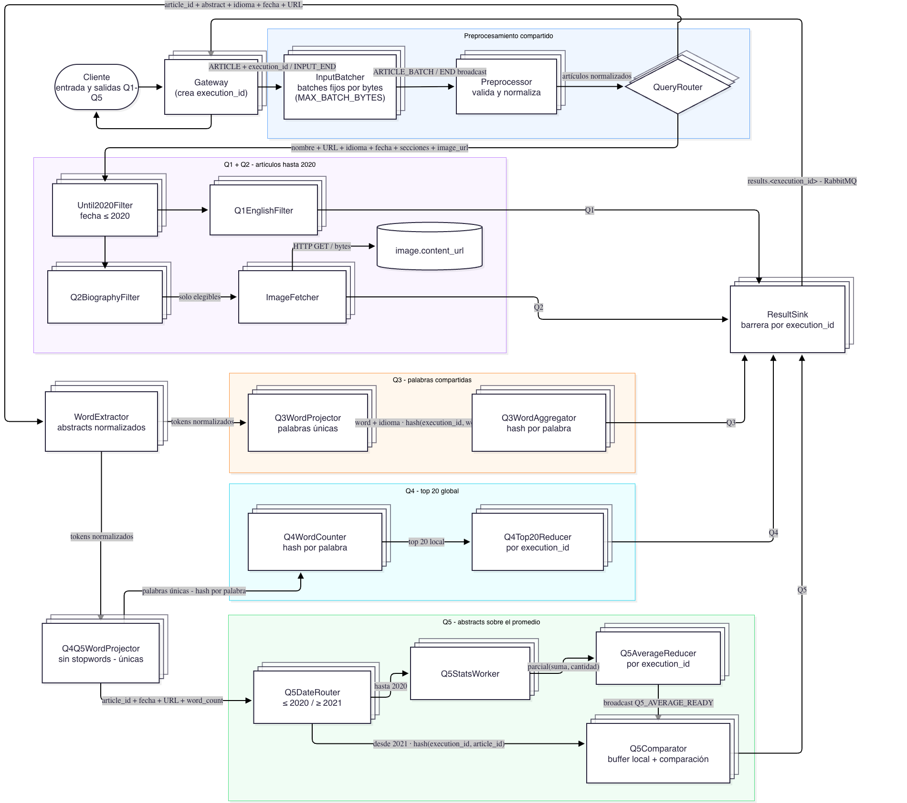

# Wikipedia Article Analysis - Informe

## 1. Resumen ejecutivo

El sistema analiza en forma distribuida artículos de Wikipedia en inglés y francés y produce cinco consultas independientes. La entrada se recibe como un stream de artículos, se normaliza una sola vez y se divide en dos ramas: una para las consultas Q1 y Q2, relacionadas con fecha, idioma, secciones e imágenes; y otra para Q3, Q4 y Q5, relacionada con el análisis textual de los abstracts.

La comunicación entre procesos se realiza mediante RabbitMQ, oculto por la capa propia de middleware. Los componentes que no mantienen estado pueden usar consumidores competidores sobre colas compartidas. Los componentes que necesitan reunir información relacionada utilizan particionado determinístico por una clave funcional, como `(execution_id, word)` o `execution_id`.

El diseño separa tres etapas de evolución:

1. **Pipeline funcional:** una réplica por componente y finales simples para validar las cinco consultas de punta a punta.
2. **Escalabilidad, dentro de este mismo hito:** múltiples réplicas, protocolo de control, `PARTITION_END`, barreras, clientes concurrentes y graceful shutdown completo.
3. **Tolerancia a fallos, en el hito posterior:** persistencia, recuperación ante caídas, deduplicación e idempotencia frente a reentregas.

Al corte de este documento se encuentran implementados el cliente, el Gateway, el ingreso incremental desde Parquet, el batching por bytes, el preprocesamiento, el fan-out del QueryRouter, las ramas funcionales de Q1, Q2, Q3 y Q4 y ResultSink. La rama textual implementada incluye WordExtractor, Q3WordProjector, Q3WordAggregator, Q4WordCounter, Q4Top20Reducer y la proyección compartida de Q4/Q5. Los resultados y finales de Q1-Q4 ya recorren `result_sink.input -> results.<execution_id> -> Gateway -> Client`; las etapas posteriores de Q5 continúan pendientes. Q4 funciona actualmente con una única partición y Q1-Q3 todavía utilizan finales provisionales; las barreras para grupos replicados continúan pendientes dentro del hito de escalabilidad.

---

## 2. Alcance y requerimientos

### 2.1 Requerimientos funcionales

El sistema recibe artículos de Wikipedia en francés e inglés y genera cinco salidas:

1. **Q1 - Artículos en inglés hasta 2020:** URL y fecha de modificación de los artículos escritos en inglés cuya fecha de modificación sea hasta 2020 inclusive.
2. **Q2 - Biografías e imágenes:** nombre, URL e imagen en bytes de los artículos hasta 2020 inclusive que contengan una sección denominada `biography` o `biographie`, sin distinguir mayúsculas y minúsculas.
3. **Q3 - Palabras compartidas:** listado sin duplicados de palabras presentes en al menos un artículo en inglés y al menos un artículo en francés.
4. **Q4 - Top 20 global:** veinte palabras más utilizadas entre todos los abstracts, excluyendo stopwords. Dentro de un mismo abstract cada palabra se contabiliza como máximo una vez.
5. **Q5 - Abstracts sobre el promedio histórico:** URL y cantidad de palabras de los artículos desde 2021 cuyo abstract supere el promedio de palabras de los abstracts hasta 2020 inclusive. Se utiliza el mismo criterio de conteo que Q4.

Cada cliente realiza una única ejecución. Distintos clientes deben poder ejecutarse concurrentemente y sin compartir estado accidentalmente. Cuando una ejecución termina o se aborta, sus recursos temporales deben limpiarse eventualmente.

### 2.2 Requerimientos no funcionales

- Procesar la entrada y entregar la salida como streams, sin cargar el dataset ni los resultados completos en memoria.
- Desplegar múltiples procesos en containers mediante Docker Compose.
- Utilizar RabbitMQ para comunicar containers.
- Ocultar los detalles de conectividad y grupos detrás de un middleware propio.
- Escalar al aumentar el volumen de una ejecución y la cantidad de clientes concurrentes.
- Permitir que al menos el 50 % de los tipos de controllers pueda escalar horizontalmente.
- Coordinar correctamente las etapas con dependencias, reductores, joiners y barreras.
- Evitar `sleep` como mecanismo de sincronización y evitar spin locks.
- Responder ordenadamente a `SIGTERM`.
- Comparar automáticamente la salida distribuida con una ejecución serial de referencia.
- Propagar solamente las columnas necesarias a cada etapa.

### 2.3 Fuera de alcance del hito actual

La consigna del hito de escalabilidad todavía supone que no fallan el cliente ni el servidor. Por eso la recuperación completa ante caída de procesos, la persistencia de mensajes, la entrega exactly-once al cliente y el escenario Chaos Monkey pertenecen al hito posterior de tolerancia a fallos.

Esto no elimina la necesidad actual de manejar errores funcionales, cerrar recursos, confirmar mensajes correctamente y realizar graceful shutdown. Solamente separa esos problemas de la recuperación automática luego de una caída.

---

## 3. Fuente de datos y referencia funcional

### 3.1 Dataset

Se utiliza Wikipedia Structured Contents, publicado en Kaggle. Durante el desarrollo se esta trabajando con una muestra reproducible de 50.000 artículos:

- 25.000 artículos en inglés
- 25.000 artículos en francés

La muestra se genera en Kaggle mediante el notebook del grupo y se descarga como `wikipedia_sample.parquet`. El archivo no se versiona en Git debido a su tamaño. El cliente lo recorre incrementalmente con PyArrow en lugar de cargarlo completo en memoria.

### 3.2 Ejecución serial

Antes de distribuir el procesamiento se implementó una referencia serial propia para Q1-Q5. Esta referencia tiene dos propósitos:

- Fijar una interpretación ejecutable de las consultas.
- Actuar como oráculo para validar la salida distribuida.

La comparación automática ignora el orden de las líneas y de las claves JSON, pero conserva la multiplicidad. De esta manera detecta tanto resultados faltantes como resultados duplicados o adicionales. Esta decisión es importante porque un sistema distribuido puede cambiar legítimamente el orden, pero no el conjunto ni la cantidad de resultados.

### 3.3 Normalización textual acordada

La interpretación funcional utilizada por la referencia y prevista para el pipeline distribuido es:

1. Convertir el texto a minúsculas.
2. Tokenizar con una regla equivalente a `\b\w+\b`.
3. Descartar tokens exclusivamente numéricos.
4. Conservar el idioma del artículo.
5. Eliminar stopwords inglesas y francesas solamente para Q4 y Q5.
6. Deduplicar palabras dentro de cada abstract antes de contabilizarlas para Q4 y Q5.

Q3 no elimina stopwords porque la consigna solicita todas las palabras compartidas entre idiomas. Q4 y Q5 comparten exactamente la misma definición de palabra contabilizable para evitar que el promedio de Q5 se calcule con una métrica diferente.

---

## 4. Organización del informe según 4+1 Views

La arquitectura se documenta con el modelo 4+1:

| Vista | Pregunta que responde | Diagramas previstos |
|---|---|---|
| Escenarios (+1) | ¿Qué casos de uso y recorridos debe soportar el sistema? | Robustez |
| Lógica | ¿Qué responsabilidades existen y cómo se transforma la información? | DAG |
| Procesos | ¿Qué ocurre en el tiempo y cómo se coordinan procesos concurrentes? | Actividades y secuencia |
| Desarrollo | ¿Cómo se organizan los paquetes y sus dependencias? | Paquetes |
| Física | ¿Dónde se despliegan los procesos y cómo se conectan? | Despliegue |

### 4.1 Inventario de diagramas


#### Vista lógica - DAG

El siguiente DAG representa el flujo completo de datos de la arquitectura objetivo, desde el ingreso de los artículos hasta la entrega de los resultados de Q1-Q5. Los bloques apilados representan componentes replicables.



#### Vista de desarrollo - Paquetes


#### Vista de procesos - Actividades


#### Vista de procesos - Secuencia


#### Vista de escenarios - Robustez


#### Vista física - Despliegue


---

## 5. Vista lógica: arquitectura general


### 5.1 Principios de diseño

1. **Streaming:** cada artículo avanza sin esperar que se cargue el dataset completo.
2. **Responsabilidad única:** cada etapa realiza una transformación acotada.
3. **Trabajo común antes de bifurcar:** se comparte la normalización y, para Q1/Q2, el filtro temporal.
4. **Proyecciones mínimas:** una rama recibe solamente los campos que necesita.
5. **Separación entre negocio y transporte:** controllers y lógica funcional no dependen directamente de Pika.
6. **Stateless cuando es posible:** facilita consumidores competidores y escalamiento horizontal.
7. **Afinidad explícita cuando hay estado:** las claves relacionadas convergen mediante hash estable.
8. **Finalización explícita:** `INPUT_END`, `PARTITION_END` y `QUERY_END` representan hechos diferentes.
9. **Estado de aplicación fuera de RabbitMQ:** MOM transporta mensajes, pero no reemplaza un almacenamiento temporal propio.
10. **Evolución verificable:** primero se obtiene una versión funcional y luego se habilita la replicación con su coordinación correcta.

### 5.2 Componentes, responsabilidades y estado

| Componente | Responsabilidad | Naturaleza objetivo | Clave de distribución | Estado actual |
|---|---|---|---|---|
| Client | Leer Parquet, enviar artículos y escribir Q1-Q5 | Externo, uno por ejecución | - | Implementado |
| Gateway | Crear ejecución, adaptar TCP/MOM y devolver resultados | Replicable por conexión | `execution_id` | Implementado, atiende un cliente por vez |
| InputBatcher | Agrupar registros sin superar el límite de bytes | Stateful por ejecución | `execution_id` | Implementado, una partición |
| Preprocessor | Validar y normalizar artículos | Stateless, replicable | Cola compartida | Implementado, una réplica |
| QueryRouter | Proyectar y bifurcar el flujo | Stateless, replicable | Cola compartida | Implementado, una réplica |
| Until2020Filter | Aplicar una vez `fecha <= 2020` | Stateless, replicable | Cola compartida | Implementado, una réplica |
| Q1EnglishFilter | Filtrar inglés y producir Q1 | Stateless, replicable | Cola compartida | Implementado, una réplica |
| Q2BiographyFilter | Detectar sección biográfica | Stateless, replicable | Cola compartida | Implementado, una réplica |
| ImageFetcher | Descargar imagen y producir Q2 | Replicable, I/O-bound | Cola compartida | Implementado secuencialmente, una réplica |
| WordExtractor | Tokenización básica compartida | Stateless, replicable | Cola compartida | Implementado, una réplica |
| Q3WordProjector | Palabras únicas de cada artículo | Stateless, replicable | Cola compartida | Implementado, una réplica |
| Q3WordAggregator | Presencia por idioma | Stateful y particionado | `(execution_id, word)` | Implementado, una partición |
| Q4Q5WordProjector | Stopwords, deduplicación y `word_count` | Stateless, replicable | Cola compartida | Implementado, una réplica |
| Q4WordCounter | Conteo global distribuido y top local | Stateful y particionado | `(execution_id, word)` | Implementado, una partición |
| Q4Top20Reducer | Fusionar tops locales | Stateful, reducers replicados | `execution_id` | Implementado, una instancia |
| Q5DateRouter | Separar histórico y candidatos | Stateless, replicable | Cola compartida | Pendiente |
| Q5StatsWorker | Suma y cantidad parciales | Stateful por ejecución local | Distribución de trabajo | Pendiente |
| Q5AverageReducer | Calcular promedio global | Stateful, reducers replicados | `execution_id` | Pendiente |
| Q5Comparator | Esperar promedio y comparar candidatos | Stateful y particionado | `(execution_id, article_id)` | Pendiente |
| ResultSink | Reenviar resultados y finales hacia cada Gateway | Stateless en la versión actual; stateful al incorporar barreras | `execution_id` | Implementado con una instancia y finales provisionales |
| MessageMiddleware | Abstraer queues, publicación dinámica, ACK/NACK y grupos | Infraestructura común | - | Queue y publisher dinámico implementados sobre RabbitMQ; interfaz de exchange definida e implementación pendiente |

### 5.3 Estado del flujo implementado

Actualmente el camino funcional de Q1, Q2, Q3 y Q4 atraviesa ResultSink y llega hasta las colas temporales `results.<execution_id>` que consume Gateway.

El QueryRouter publica la proyección textual en `word_extractor.input`. WordExtractor tokeniza los abstracts y alimenta las ramas de Q3 y Q4/Q5. Q3WordProjector deduplica palabras por artículo y las enruta por `(execution_id, word)`; Q3WordAggregator detecta la presencia en ambos idiomas y publica resultados y un final provisional. Q4Q5WordProjector elimina stopwords, deduplica por artículo y publica las proyecciones específicas en `q4_word_counter.input.0` y `q5_date_router.input`. La única instancia de Q4WordCounter produce un top local y Q4Top20Reducer lo convierte en resultados antes de publicar en `result_sink.input`. ResultSink consume los resultados de Q1, Q2, Q3 y Q4 y los reenvía inmediatamente a `results.<execution_id>`, desde donde Gateway los entrega al cliente mediante el protocolo TCP externo.

---

## 6. Identidad, aislamiento y particionado

### 6.1 `execution_id`

Gateway genera un identificador globalmente único para cada corrida mediante UUID. Todos los mensajes internos incluyen `execution_id`. Este identificador permite:

- Mantener separados los datos y estados de clientes concurrentes.
- Asignar una ejecución a una partición estable.
- Dirigir resultados a la cola temporal correcta.
- Indexar los estados de agregadores y reductores.
- Limpiar recursos al completar o abortar una corrida.

La cola de respuesta se denomina `results.<execution_id>`. Actualmente es exclusiva y autoeliminable, porque pertenece a una única conexión del Gateway.

### 6.2 `article_id`

El pipeline textual necesita identificar de manera estable cada artículo, especialmente en Q5. Los candidatos de esa query pueden quedar temporalmente guardados mientras se calcula el promedio y se distribuyen entre los comparadores mediante la clave `(execution_id, article_id)`. El identificador permite reconocer a qué artículo corresponde cada candidato, enviarlo siempre a la misma partición y, en una etapa posterior de tolerancia a fallos, detectar una posible reentrega del mismo artículo.

El dataset no provee un identificador independiente, por lo que actualmente se utiliza la URL como valor de `article_id`. Aunque hoy ambos campos contengan el mismo string, representan conceptos distintos: `url` es un dato del resultado que debe mostrarse al usuario, mientras que `article_id` es una identidad interna utilizada para routing y seguimiento. Mantenerlos separados evita acoplar esas responsabilidades y permite adoptar otro identificador en el futuro sin cambiar el significado de la URL.

### 6.3 Hash estable

No se utiliza `hash()` de Python para elegir particiones porque su resultado está aleatorizado entre procesos. Se utiliza SHA-256 y luego módulo por la cantidad de particiones:

```text
partition = sha256(key) mod partition_count
```

El objetivo es determinismo, la misma clave debe producir la misma partición en cualquier proceso y después de un reinicio.

### 6.4 Colas compartidas y colas particionadas

- Una etapa **stateless** puede consumir de una cola compartida. RabbitMQ distribuye cada mensaje a una sola réplica competidora.
- Una etapa **stateful** necesita afinidad. El productor elige explícitamente la cola de partición según una clave estable.
- Un reducer por ejecución también puede ser físicamente replicado: todos los parciales de una corrida convergen en una réplica lógica por `execution_id`, mientras otras corridas pueden usar otras réplicas.

---

## 7. Ingreso, streaming y batching

### 7.1 Cliente y protocolo TCP

El cliente itera el Parquet y envía un artículo por vez. Cada artículo debe ser confirmado por Gateway antes de continuar. Al terminar envía `INPUT_END` y luego recibe resultados progresivamente.

TCP es un stream de bytes, no un transporte de mensajes. Por eso cada frame externo se representa como:

```text
4 bytes: longitud del cuerpo, unsigned, network byte order
N bytes: cuerpo del mensaje
```

El receptor continúa leyendo hasta completar exactamente la longitud indicada. Esto evita asumir que una llamada a `recv` coincide con un mensaje completo.

El cuerpo se serializa mediante un protocolo binario propio. El primer byte identifica el tipo de mensaje externo y los valores posteriores utilizan etiquetas binarias para representar `None`, booleanos, enteros, floats, strings UTF-8, bytes, listas y diccionarios. Los valores variables incluyen su longitud en cuatro bytes y los enteros se representan con signo en ocho bytes. El decoder rechaza tipos desconocidos, mensajes truncados, UTF-8 inválido y bytes sobrantes.

El cliente no genera el JSON interno del sistema. Lee el Parquet incrementalmente, codifica cada artículo con este protocolo y lo envía por TCP. Gateway decodifica el artículo, agrega `execution_id` y `reply_queue`, construye el DTO interno y recién entonces lo serializa como JSON UTF-8 para publicarlo en RabbitMQ. La misma codificación binaria se utiliza para ACK, errores y resultados enviados por la conexión externa.

### 7.2 Gateway

Gateway adapta el protocolo externo a mensajes internos:

1. Acepta una conexión.
2. Crea `execution_id`.
3. Crea la cola temporal `results.<execution_id>`.
4. Asigna la ejecución a una partición de InputBatcher.
5. Agrega `execution_id` y `reply_queue` a artículos y al final de entrada.
6. Publica en RabbitMQ.
7. Confirma al cliente cada publicación aceptada.
8. Cuando recibe `INPUT_END`, deja de recibir artículos y comienza la fase de resultados: consume mensajes desde `results.<execution_id>` en RabbitMQ y envía cada `RESULT` o `QUERY_END` al cliente por la misma conexión TCP.

La conexión tiene entonces dos fases. Primero el cliente envía artículos y Gateway los publica en RabbitMQ. Después de `INPUT_END`, el flujo se invierte: Gateway recibe los resultados producidos por el sistema distribuido y los transmite al cliente. Por cada resultado, espera el ACK del cliente antes de confirmarlo en RabbitMQ.

La implementación actual procesa una conexión completa antes de aceptar la siguiente. La arquitectura objetivo ejecutará cada sesión en un thread o proceso separado, con conexiones RabbitMQ y recursos aislados.

### 7.3 InputBatcher limitado por bytes

Los batches se limitan por tamaño serializado real, no por cantidad de artículos. Un número fijo de artículos no controla el consumo porque los abstracts y las secciones tienen tamaños muy variables.

Para cada artículo:

1. Se construye el batch candidato.
2. Se serializa para medir su tamaño final.
3. Si no supera `MAX_BATCH_BYTES`, se conserva.
4. Si lo supera, se publica el batch anterior y el artículo inicia el siguiente.
5. Si un artículo individual supera el límite, se produce un error visible.
6. Ante `INPUT_END`, se publica el último batch parcial antes del final.

El InputBatcher mantiene estado por ejecución. Por eso todos los artículos y el final de una ejecución deben llegar a la misma partición. Distintas ejecuciones sí pueden asignarse a distintas particiones.

### 7.4 Protección frente a entradas sobredimensionadas

El framing TCP limita actualmente cada mensaje a 64 MiB y el InputBatcher rechaza un artículo que no cabe en un batch. Esto evita un mensaje individual ilimitado, pero no constituye protección completa frente a un cliente malicioso que envía repetidamente mensajes grandes.

Se posterga hasta después del pipeline funcional la incorporación de límites por tipo, cuota total por ejecución, timeouts, rate limiting, validación temprana y propagación de un error terminal. Esta postergación es aceptable mientras la entrada sea el dataset conocido, pero debe quedar resuelta antes de tratar entradas no confiables.

---

## 8. Preprocesamiento y fan-out

### 8.1 Preprocessor

El Preprocessor convierte el registro crudo en un `NormalizedArticle`:

- Valida `name` y `url`
- Extrae y normaliza el identificador de idioma
- Parsea la fecha ISO
- Transforma las secciones, almacenadas como JSON dentro del Parquet, en una lista de nombres
- Obtiene `image.content_url` cuando existe
- Conserva el abstract opcional

Esta separación evita repetir parsing en cada consulta.

### 8.2 QueryRouter

QueryRouter publica dos proyecciones mínimas:

- **Q1/Q2:** `name`, `url`, `language`, `modification_date`, `sections`, `image_url`.
- **Q3/Q4/Q5:** `article_id`, `url`, `language`, `modification_date`, `abstract`.

No filtra fecha, idioma, secciones ni palabras. Su responsabilidad es el fan-out y la reducción de columnas. El ACK de entrada ocurre después de publicar ambas salidas.

El fan-out actual tiene semántica at-least-once: si una publicación funciona y la siguiente falla, una reentrega podría repetir la primera.

---

## 9. Rama Q1/Q2

### 9.1 Filtro temporal compartido

Q1 y Q2 requieren `fecha <= 2020`. Aplicar el filtro por separado duplicaría trabajo y podría introducir interpretaciones diferentes. `Until2020Filter` evalúa la condición una sola vez y proyecta los artículos elegibles hacia ambas consultas.

Los batches vacíos no se publican, pero el final sí se propaga a ambas ramas. Esto permite que una consulta sin candidatos termine correctamente.

### 9.2 Query 1

Q1 conserva únicamente artículos con idioma normalizado `en` y produce:

```text
{
  "url": ...,
  "modification_date": ...
}
```

La fecha conserva el formato ISO de la referencia serial. Q1 es stateless y, una vez incorporado el protocolo de fin, podrá escalar con consumidores competidores.

### 9.3 Query 2: filtro biográfico

`Q2BiographyFilter` compara el nombre completo de cada sección con `biography` o `biographie`, ignorando mayúsculas. No realiza búsquedas parciales: una sección cuyo nombre solamente contenga la palabra no cumple necesariamente la condición.

El filtro conserva candidatos sin `image_url`. La decisión de omitirlos y registrarlos pertenece a ImageFetcher, que es el componente responsable de la interacción externa.

### 9.4 Query 2: descarga de imágenes

El dataset puede incluir `image.content_url`, una URL que apunta directamente al recurso de imagen. ImageFetcher realiza un HTTP GET a esa URL. La respuesta HTTP contiene headers y un cuerpo; el cuerpo se lee como `bytes` y constituye la imagen solicitada por la query.

La cátedra confirmó que es válido utilizar directamente la URL del dataset y que no es necesario consultar adicionalmente la API REST de Wikimedia. La política implementada es:

- Éxito: leer el cuerpo completo y continuar.
- HTTP 404: error permanente, registrar y omitir sin reintentar.
- Otros HTTP 4xx: registrar y omitir, salvo 429.
- HTTP 429, 5xx, timeout o error transitorio de red: reintentos acotados.
- URL ausente o reintentos agotados: registrar la omisión y continuar la ejecución.

La API REST se descartó porque no agrega información cuando la página no posee imagen y porque consultar datos actuales podría introducir una inconsistencia temporal con el snapshot del Parquet.

Como los mensajes internos de RabbitMQ y el archivo `query2.jsonl` utilizan JSON, los bytes se codifican en Base64 para formar un string transportable y escribible. Base64 aumenta el tamaño aproximadamente un 33 %. Aunque el protocolo externo admite bytes, el resultado ya llega al Gateway representado como Base64; cambiar solamente el último tramo no elimina ese overhead dentro del pipeline.

ImageFetcher descarga secuencialmente en la primera versión funcional. La arquitectura prevé múltiples réplicas y, si una réplica realiza concurrencia interna, un límite explícito para no generar carga descontrolada sobre Wikimedia.

---

## 10. Rama textual Q3/Q4/Q5

Esta sección combina el estado implementado de WordExtractor, Q3 y Q4 con la arquitectura objetivo de Q5 y del escalamiento posterior.

### 10.1 WordExtractor

WordExtractor realiza solamente transformaciones comunes: minúsculas, tokenización y descarte de tokens exclusivamente numéricos. Conserva identidad, idioma, fecha y URL. No elimina stopwords ni filtra por fecha, porque esas reglas no son comunes a las tres consultas. La versión implementada transforma `TextArticleBatchMessage` en `TokenizedArticleBatchMessage`, publica el mismo batch en las colas independientes de Q3 y Q4/Q5 y reenvía `RoutedInputEndMessage` a ambas ramas. Cada artículo tokenizado incluye `has_abstract`, que distingue un abstract ausente (`None`) de uno presente pero vacío; esta diferencia es necesaria para reproducir el denominador de Q5 de la referencia serial.

### 10.2 Q3: palabras compartidas

`Q3WordProjector` deduplica las palabras dentro de cada artículo y publica `(execution_id, word, language)`. No elimina stopwords. La versión funcional utiliza una réplica y distribuye actualmente sobre una única partición de Q3WordAggregator.

`Q3WordAggregator` se particiona por `(execution_id, word)` y mantiene:

```text
seen_en
seen_fr
emitted
```

Cuando una palabra pasa por primera vez a estar presente en ambos idiomas se emite el resultado y se marca `emitted`. Una colisión del hash solamente coloca dos palabras en la misma réplica, no mezcla sus claves en el estado interno. Al recibir `RoutedInputEndMessage`, la implementación actual publica un `QUERY_END` provisional y limpia el estado de esa ejecución. Este cierre es correcto con una sola partición; al escalar deberá reemplazarse por `PARTITION_END` y una barrera.

### 10.3 Q4: top 20 global

`Q4Q5WordProjector` omite los artículos cuyo abstract era `None`, elimina
stopwords, deduplica palabras dentro de cada artículo y publica un
`Q4WordBatchMessage` con una aparición por palabra y artículo en
`q4_word_counter.input.0`. Las repeticiones entre artículos se preservan porque
representan apariciones diferentes.

La versión funcional utiliza un solo `Q4WordCounter`. Mantiene un `Counter` por `execution_id` y, al recibir el fin, publica su top 20 local seguido de `Q4PartitionEndMessage(partition_id=0)`.

`Q4Top20Reducer` espera el final de la única partición configurada, ordena los candidatos por conteo descendente y palabra ascendente, publica un `ResultMessage` por palabra y finalmente el único `QUERY_END` de Q4.

En el diseño objetivo, Q4WordCounter se particionará por `(execution_id, word)`. Cada partición contará un subconjunto disjunto de palabras y producirá su top 20 local. El reducer fusionará esos tops y esperará un final por partición. Enviar solamente veinte candidatos por partición es suficiente: una palabra fuera del top 20 local ya tiene al menos veinte palabras de su propia partición que la superan o empatan según el criterio de orden, por lo que no puede ingresar al top 20 global. El routing por hash, el despliegue de múltiples counters y la coordinación correcta con múltiples réplicas del projector siguen pendientes dentro del hito de escalabilidad.

### 10.4 Q5: promedio y comparación

`Q4Q5WordProjector` calcula también `word_count = len(unique_words)`, garantizando el mismo criterio que Q4, y publica un `Q5ArticleWordCountBatchMessage` en `q5_date_router.input`. La proyección conserva `article_id`, URL y fecha. Los artículos sin abstract se omiten, mientras que los abstracts presentes pero vacíos se conservan con conteo cero, como en la ejecución serial.

`Q5DateRouter` divide el flujo:

- Artículos hasta 2020: `Q5StatsWorker` acumula suma y cantidad;
- Artículos desde 2021: `Q5Comparator` recibe candidatos.

Los parciales históricos convergen por `execution_id` en `Q5AverageReducer`, que calcula:

```text
average = global_sum / global_count
```

Luego difunde `Q5_AVERAGE_READY` a los comparadores de esa ejecución.

Los candidatos pueden llegar antes que el promedio. No se mantendrán sin ACK dentro de RabbitMQ porque eso usaría la MOM como base de datos y limitaría el flujo. Cada comparator los confirma después de incorporarlos a un `CandidateBuffer` de la aplicación, separado por ejecución. La opción prevista combina un índice pequeño en memoria con un archivo temporal append-only para evitar memoria ilimitada.

El comparator mantiene una máquina de estados con:

```text
average_ready
average
candidate_input_closed
buffer
```

Antes del promedio persiste candidatos; después del promedio compara directamente los nuevos y drena los anteriores. Solo finaliza cuando conoce el promedio, recibió el cierre de su entrada y no quedan candidatos pendientes. La comparación es estricta: `word_count > average`.

---

## 11. ResultSink y entrega al cliente

La implementación actual de ResultSink consume `result_sink.input` y reenvía cada `ResultMessage` o `QueryEndMessage` a `results.<execution_id>`. No acumula resultados ni espera que termine una consulta. Publica mediante el exchange por defecto de RabbitMQ con enrutamiento obligatorio y publisher confirms; recién después de confirmar esa publicación ejecuta el ACK del mensaje de entrada.

ResultSink no declara las colas de salida. Cada cola `results.<execution_id>` es exclusiva, temporal y pertenece a la conexión de Gateway que inició la ejecución. El publicador dinámico solamente la utiliza como destino; si la cola no existe, la publicación falla y el mensaje de entrada no se confirma.

En la versión funcional actual, una sola instancia reenvía los finales producidos por Q1, Q2, Q3 y Q4. Al incorporar múltiples réplicas, ResultSink se particionará por `execution_id` y agregará estado de barrera para que toda la salida de una ejecución converja en una única réplica lógica. Sus responsabilidades objetivo serán:

- Reenviar cada resultado a `results.<execution_id>` sin esperar a que termine la query, ya implementado.
- Mantener las barreras necesarias por consulta.
- Producir exactamente un `QUERY_END` por query.
- Limpiar el estado de barrera cuando finalicen las cinco consultas o falle la ejecución.

Gateway consume la cola temporal de la ejecución y aplica el siguiente ACK encadenado:

```text
RabbitMQ entrega resultado
  -> Gateway valida
  -> Gateway envía por TCP
  -> Client escribe y responde ACK
  -> Gateway confirma el mensaje en RabbitMQ
```

Esta secuencia evita confirmar un resultado antes de entregarlo al cliente. Sin embargo, todavía no garantiza una entrega **exactly-once**, es decir, que cada resultado lógico llegue al cliente una única vez incluso si ocurren reintentos o caídas.

Por ejemplo, el cliente podría escribir un resultado y responder ACK, pero Gateway podría caerse antes de confirmar ese mensaje en RabbitMQ. Al recuperarse, RabbitMQ podría entregarlo nuevamente y el cliente lo escribiría dos veces. Evitar esa duplicación requiere identificar persistentemente los resultados ya procesados y deduplicarlos. Esa garantía corresponde al hito posterior de tolerancia a fallos.

---

## 12. Comunicación interna y middleware

### 12.1 Motivo del middleware

Los componentes no importan Pika ni administran conexiones RabbitMQ directamente. Utilizan interfaces del middleware para enviar, consumir, confirmar, rechazar y cerrar.

Esto cumple dos objetivos:

- Oculta detalles de conectividad, colas y ACK a la lógica funcional.
- Permite extender la comunicación con grupos sin modificar cada controller.

### 12.2 Capacidades actuales

La implementación actual ofrece `MessageMiddlewareQueueRabbitMQ` con:

- Declaración de colas.
- Publicación.
- Consumo bloqueante.
- ACK y NACK manuales.
- `prefetch_count=1`.
- Detención del consumo.
- Cierre explícito de conexión.

Las excepciones específicas de Pika se traducen a errores propios del middleware.

### 12.3 Capacidad pendiente: comunicación por grupos

La abstracción `MessageMiddlewareExchange` ya está definida. Queda pendiente implementar `MessageMiddlewareExchangeRabbitMQ`, tomando como base la versión utilizada en el TP de Coordinación y adaptándola al protocolo de este sistema. Cada réplica tendrá su propia cola exclusiva vinculada al exchange, de modo que una publicación de control llegue a todas las réplicas del grupo. El negocio no deberá conocer bindings ni detalles de RabbitMQ. DATA continuará usando colas compartidas o particionadas; el control de finalización utilizará broadcast al grupo.

### 12.4 ACK, NACK y prefetch

Un mensaje se confirma solamente después de aplicar su efecto y publicar todas las salidas derivadas. Ante una excepción, el controller hace NACK según la política de la etapa.

`prefetch_count=1` limita a uno los mensajes no confirmados reservados por consumidor y favorece el reparto entre réplicas. No es un algoritmo estricto de “menos cargado” ni reemplaza la coordinación de finales.

---

## 13. Protocolo de finalización y barreras

### 13.1 Tipos de final

- `INPUT_END`: el cliente no enviará más artículos.
- `PARTITION_END`: una réplica o partición terminó una etapa determinada.
- `QUERY_END`: una consulta completa no producirá más resultados.
- `QUERY_FAILED`: una consulta o ejecución no puede completarse.

Confundir `INPUT_END` con `QUERY_END` produciría finales anticipados mientras todavía existen batches en vuelo.

### 13.2 Versión funcional actual

Con una sola réplica por etapa, DATA y `INPUT_END` pasan por la misma cola. El consumidor único procesa los batches anteriores y después reenvía el final. Q1 e ImageFetcher producen actualmente `QUERY_END` provisionales.

Esta solución permite comprobar el recorrido funcional, pero no es correcta al agregar consumidores competidores: una réplica podría recibir el final mientras otra todavía procesa DATA.

### 13.3 Protocolo objetivo para grupos replicados

El diseño, basado en el patrón del TP de Coordinación, es:

1. DATA y el primer END atraviesan la misma cola, preservando el orden hasta el punto de distribución.
2. Una réplica recibe el END y lo difunde mediante el exchange de control del grupo.
3. Cada réplica serializa el control con su DATA local, termina el trabajo en vuelo y publica sus parciales.
4. Cada réplica emite exactamente un `PARTITION_END(execution_id, stage, partition_id)`.
5. La etapa responsable mantiene una barrera con la cantidad configurada de particiones.
6. Solamente al completar la barrera propaga el cierre o produce `QUERY_END`.

No se asume orden entre colas distintas. Tampoco se fabrican finales durante `SIGTERM`. El estado compartido por el consumidor DATA y el consumidor de control deberá protegerse con locks o resolverse mediante un único loop serializado.

---

## 14. Escalabilidad

### 14.1 Escalamiento por volumen

Los componentes stateless que procesan el volumen principal pueden replicarse sobre colas compartidas: Preprocessor, QueryRouter, Until2020Filter, Q1EnglishFilter, Q2BiographyFilter, ImageFetcher, WordExtractor, proyectores y Q5DateRouter.

Los componentes stateful se escalan por particiones: InputBatcher, Q3WordAggregator, Q4WordCounter, Q5Comparator y ResultSink.

Los reducers Q4Top20Reducer y Q5AverageReducer se replican por ejecución. Cada corrida utiliza un reducer lógico, pero múltiples corridas pueden distribuirse entre réplicas físicas.

De este modo, más del 50 % de los tipos de controllers de la arquitectura objetivo admite escalamiento horizontal.

### 14.2 Escalamiento por clientes

`execution_id` aísla los mensajes y estados. Para atender clientes concurrentes falta hacer concurrente el Gateway y mantener una sesión independiente por conexión. El pipeline interno ya transporta el identificador necesario para separar corridas.

### 14.3 Límites del escalamiento actual

Docker Compose despliega hoy una instancia de cada componente funcional implementado y una partición de InputBatcher. Esto demuestra separación en containers y comunicación por MOM, pero todavía no demuestra escalamiento efectivo con múltiples réplicas. Esa prueba se realizará después de implementar exchanges, `PARTITION_END` y barreras.

La cantidad de particiones de una etapa stateful deberá permanecer fija mientras existan ejecuciones activas, salvo que se implemente migración explícita de estado.

---

## 15. Vista de desarrollo: paquetes y dependencias

### 15.1 Organización actual

```text
src/
  client/                 # transporte TCP y escritura de resultados
  gateway/                # sesión externa y adaptación TCP <-> MOM
  input_batcher/          # batching por ejecución y bytes
  preprocessor/           # validación y normalización
  query_router/           # fan-out y proyecciones
  until_2020_filter/      # filtro temporal compartido
  q1/                     # consulta 1
  q2/
    biography_filter/     # filtro funcional de Q2
    image_fetcher/        # I/O HTTP y resultado de Q2
  word_extractor/         # tokenización compartida de Q3/Q4/Q5
  q3/                     # proyección y agregación de Q3
  q4/
    word_counter/         # conteo de apariciones y top local de Q4
    top20_reducer/        # top global y resultados de Q4
  q4_q5_word_projector/   # proyecciones compartidas de Q4 y Q5
  result_sink/            # reenvío de resultados hacia cada Gateway
  common/
    message_protocol/     # DTOs, tipos y framing externo
    middleware/           # interfaces y adaptación RabbitMQ
  dataset/                # lectura incremental de Parquet
  infra/                  # adaptadores externos, hoy Wikimedia HTTP
  reference/              # ejecución serial y comparación
```

### 15.2 Regla de dependencias

Un DTO (*Data Transfer Object*) es un objeto simple cuyo propósito es transportar datos entre capas o procesos. No abre conexiones, no conoce RabbitMQ y no contiene la coordinación del sistema. En este proyecto, mensajes como `ArticleBatchMessage`, `Q1CandidateBatchMessage` y `ResultMessage` cumplen ese rol: agrupan los campos que una etapa recibe o publica.

La lógica de transformación recibe estos objetos de datos y produce otros. Los módulos `messaging` se ocupan de serializarlos y enviarlos mediante el middleware. Los puntos de entrada ensamblan configuración, mensajería y controller.

Esta separación evita que filtros y transformaciones dependan de RabbitMQ y permite probarlos con objetos en memoria. También evita una abstracción excesiva: se crean capas donde existe una frontera real, no una interfaz por cada función.

### 15.3 DTOs y serialización

Los mensajes se modelan como dataclasses inmutables. Se utilizan dos serializaciones distintas según la frontera:

- Cliente-Gateway: protocolo binario manual, limitado a los mensajes externos.
- Comunicación interna mediante RabbitMQ: JSON UTF-8.

Esta separación hace que Gateway sea quien genere `execution_id`, `reply_queue` y el JSON publicado en el middleware. El cliente no genera ni utiliza esos datos de enrutamiento, aunque el DTO de resultado compartido todavía transporte `execution_id` en la respuesta. Al mismo tiempo, conservar JSON dentro del DAG facilita inspeccionar las colas y estabilizar los contratos que todavía faltan para Q5 y para el protocolo de control. El costo aceptado es un mayor tamaño interno y la necesidad de Base64 para la imagen de Q2.

---

## 16. Vista física: despliegue

### 16.1 Despliegue actual

Docker Compose contiene:

- RabbitMQ 3.13 con interfaz de administración
- Gateway
- InputBatcher partición 0
- Preprocessor
- QueryRouter
- Until2020Filter
- Q1
- Q2BiographyFilter
- ImageFetcher
- WordExtractor
- Q3WordProjector y Q3WordAggregator partición 0
- Q4Q5WordProjector
- Q4WordCounter partición 0 y Q4Top20Reducer
- ResultSink
- Client bajo el profile `client`
- cAdvisor, Prometheus y Grafana bajo el profile opcional `monitoring`

Cada componente funcional posee su Dockerfile y se comunica por nombre de servicio dentro de la red de Compose. RabbitMQ expone 5672 para AMQP y 15672 para administración.

### 16.2 Despliegue objetivo

El diseño no fija Q1 o Q2 a una computadora particular. Los nodos de cómputo deben ser equivalentes y permitir ubicar réplicas donde exista capacidad. RabbitMQ es infraestructura compartida. ImageFetcher es el único componente que necesita salida HTTP hacia Wikimedia. Q5Comparator necesitará almacenamiento temporal local o volumen para su `CandidateBuffer`.

Compose permite demostrar la topología con múltiples containers. La expansión a varias computadoras requiere conservar nombres de servicios, configuración común, claves de particionado y acceso al broker; no debe requerir reescribir la lógica de negocio.

---

## 17. Manejo de errores y graceful shutdown

### 17.1 Errores funcionales

- Un mensaje inválido produce una excepción identificable, no se ignora silenciosamente.
- Un artículo mayor que el batch máximo se rechaza explícitamente.
- Los errores HTTP permanentes de imágenes se registran y omiten sin detener toda la ejecución.
- Los errores transitorios de imágenes tienen timeout y reintentos acotados.
- Gateway envía un mensaje `ERROR` al cliente cuando una sesión falla.

Queda pendiente definir una política completa de poison messages y propagar fallos internos terminales como `QUERY_FAILED` hasta el cliente.

### 17.2 Graceful shutdown objetivo

Ante `SIGTERM`, cada proceso debe:

1. Dejar de solicitar DATA nuevo
2. Terminar tareas cortas ya iniciadas
3. Confirmar solamente trabajo completo
4. Reencolar trabajo incompleto
5. Confirmar publicaciones pendientes
6. Hacer flush de estado o archivos propios
7. Cerrar sockets y conexiones RabbitMQ
8. Finalizar sin inventar `PARTITION_END`

La implementación actual cierra recursos en sus flujos normales, pero el manejo coordinado de `SIGTERM` para todos los procesos todavía está pendiente dentro de este hito.

---

## 18. Durabilidad y tolerancia a fallos

Las colas actuales son no durables y los mensajes no son persistentes. Esto es coherente con el alcance funcional del hito de escalabilidad, pero no permite recuperar el sistema luego de reiniciar RabbitMQ.

Declarar una cola durable no alcanza por sí solo. Una solución completa necesita además mensajes persistentes, almacenamiento persistente del broker, restauración del estado de aplicación, idempotencia y deduplicación.

Las colas `results.<execution_id>` son deliberadamente temporales, exclusivas y autoeliminables. Su ciclo de vida coincide con la sesión del Gateway.

En el hito de tolerancia a fallos se revisarán:

- Persistencia de mensajes y estado
- Reanudación de ejecuciones
- Deduplicación mediante `message_id` o `article_id`
- Exactly-once hacia el cliente
- Recuperación de CandidateBuffer
- Chaos Monkey automatizado
- Limpieza de ejecuciones resueltas o fallidas

---

## 19. Monitoreo

El monitoreo es opcional y está aislado mediante el profile `monitoring`. La solución utiliza:

- cAdvisor para métricas de containers
- Prometheus para scraping y almacenamiento temporal de métricas
- el plugin nativo de RabbitMQ para métricas del broker
- Grafana con datasource y dashboard aprovisionados

El dashboard permite observar CPU, memoria, red, mensajes pendientes y no confirmados, consumidores, publicaciones, confirmaciones y reentregas. Esto servirá para justificar dónde agregar réplicas y comprobar que el cuello de botella se desplaza al escalar una etapa.

El monitoreo no participa del flujo funcional y su caída no debe impedir el procesamiento.

---

## 20. Decisiones arquitectónicas y trade-offs

| Decisión | Alternativas consideradas | Motivo de la elección | Costo o riesgo |
|---|---|---|---|
| Python | Go | El grupo ya trabajó en Python y las librerías necesarias son conocidas | Menor rendimiento bruto y presencia del GIL; se escala con procesos/containers |
| RabbitMQ | Kafka, ZeroMQ, sockets entre procesos | Alineado con trabajos previos, soportado por la cátedra y apropiado para colas y ACK | Broker central y necesidad de coordinar grupos explícitamente |
| Middleware propio | Pika dentro de cada componente | Cumple la consigna y desacopla negocio de conectividad | Hay que diseñar y mantener la abstracción |
| Streaming de Parquet | Cargar dataset completo | Memoria acotada y cumplimiento del criterio de streaming | Mayor cantidad de mensajes y necesidad de batching |
| Batches por bytes | Cantidad fija de artículos | Controla el tamaño real pese a artículos heterogéneos | Medir requiere serializar el batch candidato |
| SHA-256 para particionar | `hash()` de Python | Determinismo entre procesos y reinicios | Más CPU que un hash no criptográfico, irrelevante frente al beneficio actual |
| Normalización temprana | Parsear en cada query | Evita duplicación e interpretaciones divergentes | El artículo normalizado contiene campos para más de una rama hasta el fan-out |
| Proyecciones mínimas | Propagar el artículo completo | Menos tráfico y menor acoplamiento | Más tipos de mensajes |
| Filtro temporal común Q1/Q2 | Un filtro por query | Evalúa una sola vez la misma condición | Introduce una etapa compartida adicional |
| URL directa de imagen | Wikimedia REST API | La cátedra lo confirmó; respeta el snapshot y evita una consulta redundante | URLs antiguas pueden responder 404 |
| Omitir imagen tras error permanente | Fallar toda la ejecución | Un recurso externo ausente no invalida las demás consultas | Q2 puede tener menos resultados que candidatos funcionales |
| Base64 en mensajes internos y JSONL | Lista de enteros o bytes crudos | Representación estándar y compatible con RabbitMQ JSON y el archivo final | Aproximadamente 33 % de overhead |
| Binario externo y JSON interno | JSON también entre cliente y Gateway, o binario en todo el DAG | Mantiene al cliente mínimo y construye el JSON recién en Gateway, sin perder inspección simple de las colas | Se mantienen dos codecs y JSON conserva overhead dentro del pipeline |
| Una réplica primero | Implementar barreras desde el inicio | Permite validar funcionalidad de punta a punta incrementalmente | No demuestra aún escalabilidad y los finales son provisionales |
| Colas compartidas para stateless | Particionar todas las etapas | Balanceo automático y menor afinidad | Requiere protocolo de cierre por grupo |
| Particionado para stateful | Estado global compartido | Evita locks distribuidos y mantiene cada clave en un dueño lógico | La cantidad de particiones no cambia libremente durante una ejecución |
| Reducers replicados por ejecución | Singleton global | Diferentes clientes se reducen en paralelo | Una ejecución individual converge en un reducer lógico |
| CandidateBuffer de aplicación | Dejar candidatos Q5 sin ACK en RabbitMQ | Evita usar la MOM como base de datos y libera el flujo | Requiere ciclo de vida y almacenamiento temporal propios |
| Colas no durables en este hito | Durabilidad completa inmediata | Separa escalabilidad de tolerancia a fallos | Un reinicio del broker pierde trabajo |
| Monitoreo opcional | Siempre activo o inexistente | Permite medir sin agregar dependencia funcional | La demo debe iniciarlo explícitamente si se quiere mostrar |

---

## 21. Alternativas descartadas en detalle

### 21.1 Consultar la API REST cuando falta `image.content_url`

Se probó con candidatos del dataset y se observó que muchos artículos sin `image` tampoco tenían imagen visible en su página. Consultar el estado actual de Wikipedia no garantiza encontrar una imagen y puede mezclar el snapshot del dataset con contenido posterior. Después de consultar a la cátedra se adoptó el uso directo de `content_url` y el manejo ordenado de 404.

### 21.2 Usar RabbitMQ como buffer de Q5

Mantener candidatos sin ACK hasta conocer el promedio aplicaría backpressure indefinido, ocuparía mensajes en vuelo y convertiría al broker en almacenamiento de estado funcional. El CandidateBuffer consume y confirma los candidatos y hace explícita la dependencia temporal dentro de la aplicación.

### 21.3 Un reducer global único

Es simple, pero todas las ejecuciones competirían por el mismo proceso. Particionar reducers por `execution_id` conserva una reducción lógica por corrida y distribuye clientes diferentes entre réplicas.

### 21.4 Propagar END como un mensaje DATA ordinario con varias réplicas

Un único consumidor recibiría el final y podría reenviarlo antes de que otros terminen. Por eso el final entra ordenado por la cola DATA y luego se difunde al grupo; la etapa siguiente espera una barrera de `PARTITION_END`.

### 21.5 Utilizar el mismo formato en TCP y RabbitMQ

Se descartó mantener JSON en ambos tramos porque eso obligaba al cliente a construir la representación que utilizaría el sistema interno. También se descartó, por ahora, convertir todo el DAG a binario: los contratos de Q4 y Q5 todavía no están estabilizados y JSON facilita inspeccionar mensajes durante el desarrollo y la demo. La solución separa ambas fronteras: protocolo binario externo y JSON interno construido después de Gateway.

---

## 22. Validación

### 22.1 Niveles de prueba

- **Unitarias:** normalización, batching, filtros, routing, descarga y transformación de resultados.
- **Controllers con dobles:** ACK/NACK, orden de publicación y propagación del final.
- **Smoke tests con RabbitMQ:** mensaje real entre containers y verificación de la cola siguiente.
- **Punta a punta:** cliente real, dataset de muestra, cinco archivos de salida.
- **Comparación automática:** salida distribuida contra la referencia serial.
- **Escalabilidad:** repetir con distintas cantidades de réplicas y comprobar mismo resultado.
- **Cierre:** enviar SIGTERM durante procesamiento y observar que no se produzcan finales falsos.

### 22.2 Evidencia disponible al corte

- La suite local completa pasa con 150 tests.
- Se verificó el recorrido Q1 hasta `result_sink.input` con RabbitMQ real.
- Se verificó Q2 desde `until_2020.input` hasta resultados Base64 y `QUERY_END` provisional.
- Se verificó que un candidato sin URL se registra y se omite.
- Se verificó que HTTP 404 no reintenta y que errores transitorios sí lo hacen de forma acotada.
- Se verificó el recorrido de Q3 con RabbitMQ real desde `word_extractor.input` hasta un resultado compartido y su `QUERY_END` provisional en `result_sink.input`.
- Se verificó con RabbitMQ real que ResultSink reenvía un resultado hacia una cola exclusiva `results.<execution_id>` ya declarada por Gateway y confirma posteriormente la entrada.
- Se verificó que ResultSink finaliza con código 0 ante `SIGTERM`.
- Se verificó con RabbitMQ real que Q4Q5WordProjector consume un batch tokenizado, publica las dos proyecciones con los mismos metadatos de ejecución y propaga el final a ambas ramas.
- Se verificó dentro de su imagen Docker que Q4Q5WordProjector dispone de las stopwords de NLTK sin depender de una descarga durante el arranque.
- Se verificó con RabbitMQ real el recorrido funcional de Q4 desde `q4_q5_word_projector.input` hasta sus resultados ordenados y un único `QUERY_END` en `result_sink.input`.
- Se verificó el arranque separado de los containers implementados.

Todavía falta la prueba punta a punta completa porque Q5 no está implementada; el cliente espera los cinco `QUERY_END` antes de finalizar.

---

## 23. Plan de demo

La demo final deberá ensayarse y ser reproducible. El recorrido previsto es:

1. Preparar la muestra Parquet
2. Ejecutar la referencia serial
3. Levantar el sistema distribuido con Docker Compose
4. Mostrar múltiples containers y, si corresponde, varias réplicas
5. Ejecutar uno o más clientes
6. Observar resultados progresivos y métricas
7. Esperar los cinco `QUERY_END`
8. Ejecutar la comparación automática
9. Demostrar igualdad de los cinco archivos
10. Enviar SIGTERM y mostrar el cierre ordenado
11. Explicar con los diagramas dónde se encuentra el estado y cómo se completan las barreras


---

## 24. Limitaciones actuales y trabajo pendiente

### 24.1 Para completar el pipeline funcional

1. Implementar Q5DateRouter, estadísticas, promedio, CandidateBuffer y comparator.
2. Ejecutar Q1-Q5 desde el cliente y comparar con la referencia.

### 24.2 Para completar el hito de escalabilidad

1. Implementar `MessageMiddlewareExchangeRabbitMQ` e integrarlo con los grupos de control.
2. Definir `PARTITION_END` y barreras por etapa.
3. Reemplazar los `QUERY_END` provisionales de Q1/Q2/Q3.
4. Configurar múltiples réplicas y particiones.
5. Permitir clientes concurrentes en Gateway.
6. Limitar concurrencia HTTP de ImageFetcher.
7. Completar graceful shutdown.
8. Medir el sistema y justificar cantidades de réplicas.
9. Actualizar y exportar todos los diagramas 4+1.

### 24.3 Mejoras posteriores al pipeline funcional

- límites y cuotas para entradas no confiables
- propagación integral de `QUERY_FAILED`
- política explícita de poison messages
- limpieza completa de recursos de ejecuciones abortadas

### 24.4 Hito posterior de tolerancia a fallos

- colas y mensajes persistentes donde corresponda
- recuperación del estado de aplicación
- idempotencia y deduplicación
- exactly-once hacia el cliente
- Chaos Monkey automatizado
- recuperación y limpieza de CandidateBuffer

---

## 25. Invariantes arquitectónicos

1. Todos los artículos y `INPUT_END` de una ejecución llegan a la misma partición de InputBatcher.
2. Ningún batch supera `MAX_BATCH_BYTES`.
3. El último batch se publica antes de propagar el final.
4. Una etapa replicada no termina hasta completar su barrera.
5. Cada query produce exactamente un `QUERY_END`.
6. La misma clave stateful llega siempre a la misma partición lógica.
7. Q1 y Q2 evalúan `fecha <= 2020` una sola vez.
8. Q4 y Q5 usan el mismo criterio de conteo.
9. RabbitMQ no almacena candidatos de Q5 a la espera del promedio.
10. Q5Comparator no finaliza sin promedio, cierre de candidatos y buffer vacío.
11. Un ACK ocurre después de completar el efecto y publicar las salidas.
12. Un `SIGTERM` no produce finales falsos.
13. Todos los estados mutables se aíslan al menos por `execution_id`.
14. Las proyecciones no transportan columnas innecesarias.
15. Los errores externos permanentes se registran; no se descartan silenciosamente ni se reintentan indefinidamente.

---

## 26. Glosario

- **ACK:** confirmación de que un mensaje fue procesado correctamente.
- **NACK:** rechazo de un mensaje; puede permitir su reentrega.
- **Backpressure:** mecanismo por el cual una etapa lenta limita la velocidad de las anteriores.
- **Batch:** conjunto de registros transportados en un único mensaje.
- **Barrera:** coordinación que espera la finalización de todas las particiones necesarias.
- **Controller:** proceso que consume mensajes, invoca lógica funcional y publica salidas.
- **DTO (*Data Transfer Object*):** objeto simple que agrupa los datos transferidos entre capas o procesos, sin conexiones ni coordinación propia.
- **Exactly-once:** garantía de que cada resultado lógico se entrega y procesa una única vez, incluso si existen reintentos o caídas.
- **Fan-out:** publicación de una entrada en varias ramas independientes.
- **MOM:** middleware orientado a mensajes.
- **Partición lógica:** subconjunto estable de claves asignado a un consumidor stateful.
- **Prefetch:** cantidad de mensajes que el broker puede entregar sin confirmación a un consumidor.
- **Reducer:** etapa que reúne resultados parciales para calcular un resultado global.
- **Stateless:** componente cuyo resultado depende solamente del mensaje actual.
- **Stateful:** componente que necesita conservar información entre mensajes relacionados.
- **Trade-off:** costo aceptado al priorizar una propiedad sobre otra.

---

## 27. Registro de decisiones confirmadas con nuestro corrector

| Tema | Decisión |
|---|---|
| Query 2 | Se permite usar directamente `image.content_url` del dataset. |
| HTTP 404 | Debe manejarse ordenadamente; no invalida toda la ejecución. |
| Prioridad de desarrollo | Primero lograr el pipeline completo de punta a punta. |
| Serialización externa | El cliente envía un protocolo binario; Gateway construye después los mensajes JSON internos. |
| JSON interno | Puede mantenerse en RabbitMQ para estabilizar e inspeccionar los contratos del DAG. |
| Escalabilidad | Múltiples réplicas, control y barreras pertenecen a este hito, no al de tolerancia. |
| Tolerancia a fallos | Persistencia, recuperación e idempotencia se profundizan en el hito posterior. |
